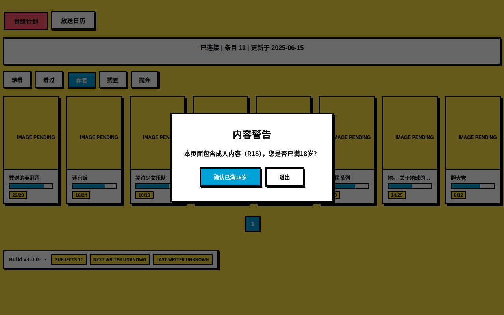
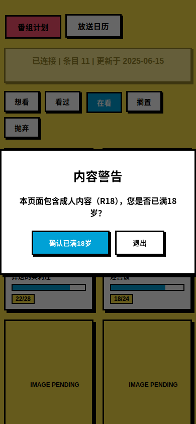
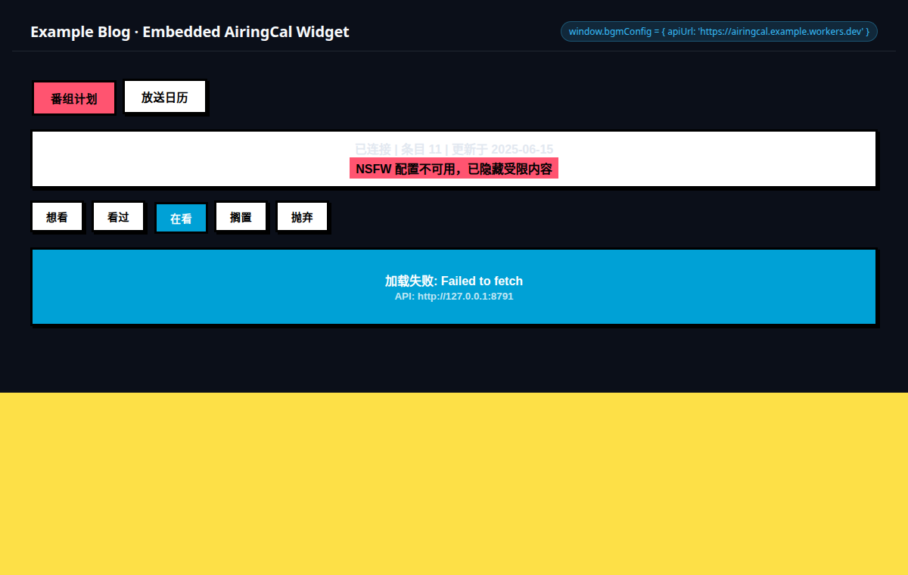

# AiringCal

**Your personal Bangumi anime calendar & progress tracker — self-hosted on Cloudflare Workers and private R2 with zero servers to maintain.**

[English](README.md) | [简体中文](README.zh-CN.md)

---

## What Is AiringCal?

**AiringCal** is an open-source personal anime collection and weekly airing calendar viewer powered by your [Bangumi (bgm.tv)](https://bgm.tv) account.

It synchronizes your anime collections (`watching`, `want`, `watched`, `on_hold`, `dropped`), episode watch progress, weekly broadcast schedule, and cover thumbnails into a **private Cloudflare R2 bucket** via a **one-shot GitHub Actions Portable Writer**, and serves a fast, responsive web Reader and embeddable Widget from a **stateless Cloudflare Worker**.



<p align="center">
  
  &nbsp;&nbsp;
  
</p>

### Key Capabilities

- **Weekly Airing Calendar & Collection Tabs**: Browse your active watching list, completed series, backlog, and 7-day airing schedule with instant search, sort, and progress bars.
- **Embeddable Personal Blog Widget**: Drop a single `<script>` and `<link>` tag into any personal blog or static site (Hexo, Hugo, Astro, VitePress, Next.js) to display your live anime progress.
- **Single-Bucket Private-R2 Security**: Only one private R2 bucket per environment (`airingcal-production` or `airingcal-development`). `r2.dev` is disabled; public release objects (`public/*`, `snapshots/*`, `images/*`) are served strictly through an allowlisted Cloudflare Worker route while internal SQLite checkpoints (`checkpoints/*`) are never anonymously reachable.
- **Two-Token Guided Setup (`pnpm run setup`)**: Interactive and headless setup wizard that discovers your Cloudflare account, `workers.dev` subdomain, and Bangumi identity, provisions a bucket-scoped R2 Writer credential, configures your GitHub Environment, deploys the Cloudflare Reader Worker, and verifies isolation.
- **Safe Install, Update & Recovery Contract**: Explicitly distinguishes `install`, `update`, and `recover` operations. Updating an existing installation verifies resource ownership and Worker R2 bindings before any mutation and preserves your existing bucket data, release lineage, checkpoints, images, and Writer secrets.
- **Fork-First Compatibility**: Automatically resolves your fork's `<owner>/<repo>` and default branch without hardcoded upstream repository or branch assumptions.

---

## Architecture Overview

```text
┌──────────────────────┐      Scheduled / Manual       ┌───────────────────────────────────┐
│   Bangumi API        │ ────────────────────────────▶ │  GitHub Actions Portable Writer   │
│   (api.bgm.tv)       │   Collections + Ep Progress   │  (.github/workflows/              │
└──────────────────────┘                               │   portable-writer.yml)            │
                                                       └─────────────────┬─────────────────┘
                                                                         │
                                                     CAS Lease + Atomic  │ S3 API (Bucket-Scoped Token)
                                                     Release Pointer     ▼
                                                       ┌───────────────────────────────────┐
                                                       │  Private Cloudflare R2 Bucket     │
                                                       │  • checkpoints/builder.sqlite     │
                                                       │  • checkpoints/lease.json         │
                                                       │  • snapshots/v1/<gen>-<sha>.json  │
                                                       │  • public/current-release.json    │
                                                       │  • images/<sha256>/{original,...} │
                                                       └─────────────────┬─────────────────┘
                                                                         │
                                                      Native R2 Binding  │ (AIRINGCAL_R2)
                                                                         ▼
┌──────────────────────┐     HTTPS (Viewer / JSON)     ┌───────────────────────────────────┐
│  Browser / Blog      │ ◀──────────────────────────── │  Cloudflare Reader Worker         │
│  Widget / RSS-like   │     Immutable Edge Cache      │  (apps/v3-read-worker)            │
└──────────────────────┘                               └───────────────────────────────────┘
```

- **Supported Environments**: `production` (`airingcal-production`) and `development` (`airingcal-development`).
- **Write Plane**: GitHub Actions (`portable-writer.yml`) restores `checkpoints/builder.sqlite` from R2, runs incremental synchronization (with automatic full reconciliation every N days, default 7), uploads content-addressed cover thumbnails and snapshots, renews its CAS lease, and atomically commits `public/current-release.json`.
- **Read Plane**: Cloudflare Worker (`apps/v3-read-worker`) serves the Web UI (`/`), Widget assets (`/src/bangumi.js`, `/src/bangumi.css`), v2-compatible JSON APIs (`/api/collections`, `/api/calendar`, `/api/health`, `/api/config`, `/api/version`), and content-addressed images (`/image/:hash`).

---

## Prerequisites

Before installing or developing AiringCal, ensure your environment meets these requirements:

| Requirement | Version / Scope | Notes |
| :--- | :--- | :--- |
| **Node.js** | `>= 24` (`v24.x`) | Required by the workspace (`engines.node: ">=24"`) and native SQLite builder (`node:sqlite`) |
| **pnpm** | `9.15.9` (`packageManager`) | Enable via `corepack enable` |
| **GitHub CLI (`gh`)** | Authenticated (`gh auth status`) | Must have write/admin access to your target repository/fork |
| **Cloudflare Account** | Free or Paid plan with **Workers** & **R2** enabled | Ensure your `workers.dev` subdomain is registered once in the Cloudflare dashboard |
| **Cloudflare API Token** | Account: `Workers R2 Storage:Edit`, `Workers Scripts:Edit`<br>User: `User Details:Read`, `API Tokens:Edit` *(or supply an independent bucket-scoped R2 S3 key)*<br>Zone *(optional, Custom Domain only)*: `Zone:Read`, `DNS:Edit` | Create at [Cloudflare API Tokens](https://dash.cloudflare.com/profile/api-tokens) |
| **Bangumi Personal Access Token** | Standard personal access token | Create at [Bangumi Access Token](https://next.bgm.tv/demo/access-token) |

---

## Quick Start: Install, Update & Recover

### 1. Fork & Clone

1. Fork this repository on GitHub (or use your own repository copy).
2. Clone your repository locally and install dependencies:

```bash
git clone https://github.com/<your-owner>/<your-repo>.git
cd AiringCal
corepack enable
pnpm install --frozen-lockfile
```

### 2. Run the Interactive Setup Wizard (`pnpm run setup`)

```bash
pnpm run setup
```

The wizard guides you through:

1. **Menu Action**: Choose **Install or Update**, **Validate API Credentials** (read-only preflight), or **Doctor** (read-only health check).
2. **Environment Selection**: Choose **Production** (recommended for personal use) or **Development**.
3. **Credential Validation**: Paste your Cloudflare API Token and Bangumi Personal Access Token (masked input; kept in session memory only, never echoed or committed).
4. **Automatic Discovery**: Discovers your Cloudflare Account ID, `workers.dev` subdomain, Bangumi user ID/username, and existing installation state (`install`, `update`, or `recover`).
5. **Domain Choice**: Use your default `https://airingcal-production.<subdomain>.workers.dev` URL (no DNS changes required) or attach a Custom Domain from a Cloudflare zone in the same account.
6. **Plan Review & Apply**:
   - **Fresh Install (`install`)**: Creates private R2 bucket `airingcal-production`, provisions bucket-scoped Writer token `airingcal-production-writer`, verifies bucket emptiness, disables `r2.dev`, syncs GitHub Environment `production`, deploys the Cloudflare Worker, and proves checkpoint route isolation.
   - **Existing Installation (`update`)**: Verifies bucket ownership, Worker R2 binding (`AIRINGCAL_R2`), GitHub Environment consistency, and existing release pointer **before** any mutation. Preserves all existing bucket objects, snapshots, checkpoints, images, and GitHub S3 secrets while redeploying the updated Cloudflare Reader Worker.
   - **Interrupted Attempt (`recover`)**: Reconciles partial resources and safely resumes after explicit confirmation.
7. **First Full Sync**: For a new installation, optionally authorizes and dispatches the initial `portable-writer.yml` Full Sync run in GitHub Actions (opening and closing the temporary bootstrap gate automatically) and runs the 25-check live verifier (`scripts/v3-ship-verify.mjs`).

---

## AI-Native Installation & Update Instructions

If you use an AI coding agent (Claude Code, Cursor, Antigravity, Windsurf, OpenAI Codex, etc.), copy and paste the prompt block below into your agent:

```markdown
You are operating inside an AiringCal repository checkout. Follow these exact rules to install, update, or diagnose AiringCal:

1. Read `docs/DEPLOYMENT.md` first. Never guess CLI flags or environment variable names.
2. Verify prerequisites (read-only):
   - `node -v` (must be >= 24)
   - `pnpm -v` (9.x)
   - `gh auth status`
   - `git remote get-url origin` (must point to the user's GitHub repository/fork)
3. For read-only diagnostics of an existing setup, run:
   - `pnpm run setup -- --doctor --environment production`
4. Prefer the interactive wizard (`pnpm run setup`) in a user terminal so credentials are entered via masked prompts and never appear in chat logs or shell history.
5. If the user explicitly requests non-interactive/headless execution using a local `.env.production` file (mode 0600, gitignored), verify the target repository (`AIRINGCAL_REPOSITORY=<owner>/<repo>`), preview the dry-run plan first (`AIRINGCAL_ENV=production AIRINGCAL_DOTENV_PATH=.env.production node scripts/deploy-env.mjs --dry-run --target cloudflare`), and require explicit user confirmation before setting `AIRINGCAL_PRODUCTION_APPLY_AUTHORIZED=yes` and `AIRINGCAL_DEPLOY_LIVE_CONFIRM=yes`.
6. Never print, log, or commit secret values (`AIRINGCAL_CLOUDFLARE_API_TOKEN`, `AIRINGCAL_BANGUMI_TOKEN`, `AIRINGCAL_S3_*`).
```

---

## Embedding the Widget & Using the API

### Standalone Web Reader

Your deployed Cloudflare Worker serves the full standalone Reader UI at its root URL:

```text
https://airingcal-production.<your-subdomain>.workers.dev/
```

### Embed in Your Personal Website or Blog

To embed AiringCal on an external domain (e.g., `https://blog.example.com`), add your blog origin to `AIRINGCAL_CORS_ORIGINS` and include the stylesheet and script:

```html
<link rel="stylesheet" href="https://airingcal-production.<your-subdomain>.workers.dev/src/bangumi.css">

<div class="bgm-container"></div>

<script>
  window.bgmConfig = {
    apiUrl: 'https://airingcal-production.<your-subdomain>.workers.dev',
    quote: 'Tracking anime via Bangumi & AiringCal'
  };
</script>
<script src="https://airingcal-production.<your-subdomain>.workers.dev/src/bangumi.js"></script>
```

### Public Read API Summary

| Endpoint | Method | Description |
| :--- | :--- | :--- |
| `/` | `GET`, `HEAD` | Standalone HTML Reader page |
| `/src/bangumi.js`, `/src/bangumi.css`, `/src/cache.js` | `GET`, `HEAD` | Embeddable Widget script, styles, and client cache helper |
| `/api/collections?type=watching&page=1&limit=24` | `GET`, `HEAD` | Paginated anime collections (`watching`, `want`, `watched`, `on_hold`, `dropped`) with search (`q`) and sort (`sort`) |
| `/api/calendar` | `GET`, `HEAD` | 7-day airing calendar enriched with personal collection status |
| `/api/health` | `GET`, `HEAD` | Release generation, publish timestamp, subject counts, and scheduler status |
| `/api/config?key=nsfw` | `GET`, `HEAD` | Public reader configuration (`nsfw` visibility flag) |
| `/api/version` | `GET`, `HEAD` | Runtime platform (`cloudflare`), schema version, and package version (`3.0.0`) |
| `/image/:sha256?variant=thumb` | `GET`, `HEAD` | Content-addressed WebP cover thumbnail or original cover image |
| `/public/current-release.json` | `GET`, `HEAD` | Current immutable release pointer |

See **[`docs/API_AND_WIDGET.md`](docs/API_AND_WIDGET.md)** for full query parameters, response schemas, caching semantics, and CORS details.

---

## Enabling Scheduled Synchronization

By default, `pnpm run setup` leaves the recurring schedule gate **disabled** so you stay in full control of GitHub Actions usage. Once your First Full Sync is verified:

1. Enable the repository-level schedule gate variable on your repository:
   ```bash
   gh variable set AIRINGCAL_WRITER_ENABLED --repo <owner>/<repo> --body true
   ```
2. Enable the environment-level Writer gate for the environment(s) you want the 6-hour cron (`17 */6 * * *`) to update:
   - For Production scheduled runs: create/set `AIRINGCAL_PRODUCTION_BOOTSTRAP_WRITER_ENABLED=true` in the `production` GitHub Environment (or dispatch manual runs via `gh workflow run portable-writer.yml -f target=production`).
   - For Development scheduled runs: set `AIRINGCAL_DEVELOPMENT_WRITER_ENABLED=true` in the `development` GitHub Environment.
3. Ensure the `portable-writer.yml` workflow is active:
   ```bash
   gh workflow enable portable-writer.yml --repo <owner>/<repo>
   ```

---

## Known Limitations & Deferred Scope

- **Cloudflare-Only Reader in `v3.0.0`**: Cloudflare Workers + Private R2 is the sole supported production deployment topology in `v3.0.0`. Additional reader platforms (Tencent EdgeOne Pages/Makers [#210](https://github.com/Skyline-Gazer/AiringCal/issues/210), Vercel [#211](https://github.com/Skyline-Gazer/AiringCal/issues/211), Netlify [#212](https://github.com/Skyline-Gazer/AiringCal/issues/212)) are tracked as post-`v3.0.0` backlog items.
- **Unreadable GitHub Secrets on Update**: GitHub Actions Environment secrets (`AIRINGCAL_PRODUCTION_S3_*`) are write-only and cannot be read back locally. When updating an existing installation without supplying local `AIRINGCAL_S3_*` credentials, `pnpm run setup` preserves your existing GitHub secrets and verifies your Writer token's active status and bucket-scoped policy via the Cloudflare API, reporting runtime S3 verification as `UPDATED_PARTIAL_VERIFICATION` (`not-verified-github-secret-only`).

---

## Documentation Index

- **Deployment, Update & Recovery Guide**: [`docs/DEPLOYMENT.md`](docs/DEPLOYMENT.md) | [简体中文](docs/DEPLOYMENT.zh-CN.md)
- **HTTP Read API & Widget Integration**: [`docs/API_AND_WIDGET.md`](docs/API_AND_WIDGET.md) | [简体中文](docs/API_AND_WIDGET.zh-CN.md)
- **System Architecture & Security Model**: [`docs/ARCHITECTURE.md`](docs/ARCHITECTURE.md)
- **Portable Writer Operator Contract**: [`apps/node-jobs/docs/operator-contract.md`](apps/node-jobs/docs/operator-contract.md)
- **Release Acceptance & Legacy Recoverability Evidence**: [`docs/v3/release-acceptance-evidence.md`](docs/v3/release-acceptance-evidence.md)
- **Release History**: [`CHANGELOG.md`](CHANGELOG.md)
