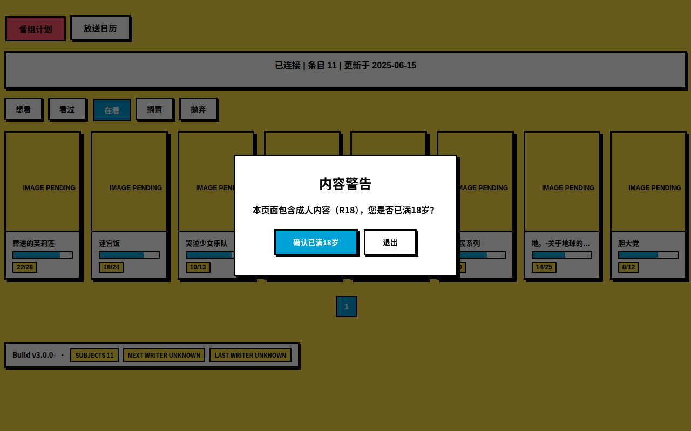
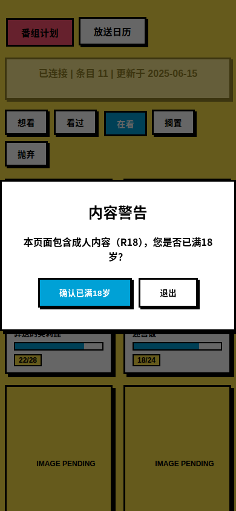
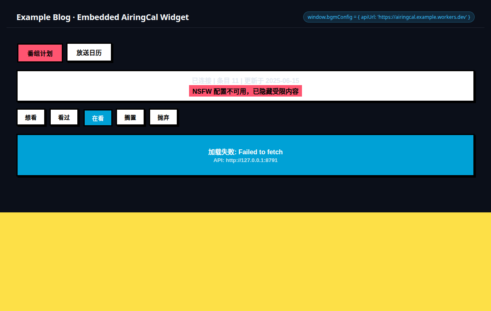

# AiringCal

**个人 Bangumi 追番日历与观看进度追踪器 —— 基于 Cloudflare Workers 与私有 R2 自托管，零服务器运维成本。**

[English](README.md) | [简体中文](README.zh-CN.md)

---

## 项目简介

**AiringCal** 是一个基于你个人 [Bangumi (bgm.tv)](https://bgm.tv) 账号的开源动画收藏与每周放送日历展示系统。

系统通过 **GitHub Actions 一次性 Portable Writer** 将你的动画收藏（`在看`、`想看`、`看过`、`搁置`、`抛弃`）、单集观看进度、每周放送时间表以及封面缩略图同步至 **私有 Cloudflare R2 存储桶**，并由 **无状态 Cloudflare Worker** 提供极速的 Web 阅读器页面与可嵌入个人博客的 Widget 组件。



<p align="center">
  
  &nbsp;&nbsp;
  
</p>

### 核心特性

- **每周放送日历与五态收藏页签**：浏览正在追番、已看、想看列表及七日放送表，支持即时搜索、多维排序与单集进度条展示。
- **可嵌入个人博客的 Widget 组件**：只需在个人博客或静态站点（Hexo、Hugo、Astro、VitePress、Next.js 等）中引入一行 `<link>` 与 `<script>`，即可展示实时追番进度。
- **单桶私有 R2 安全隔离**：每个环境仅使用一个私有 R2 存储桶（`airingcal-production` 或 `airingcal-development`）。默认禁用 `r2.dev` 匿名访问；公开 Release 对象（`public/*`、`snapshots/*`、`images/*`）仅通过 Cloudflare Worker 白名单路由对外提供，内部 SQLite 检查点（`checkpoints/*`）绝不可被匿名访问。
- **双 Token 交互式安装向导 (`pnpm run setup`)**：支持交互式与无头（Headless）模式，自动发现 Cloudflare 账号、`workers.dev` 子域名与 Bangumi 身份，自动签发限定单桶权限的 R2 Writer 凭据、同步 GitHub Environment、部署 Cloudflare Reader Worker 并完成私有隔离验证。
- **安全的安装、更新与恢复契约**：显式区分 `install`（全新安装）、`update`（现有更新）与 `recover`（中断恢复）。更新现有实例时，在执行任何变更前先校验存储桶归属与 Worker 的 `AIRINGCAL_R2` 绑定关系，完整保留现有桶内数据、Release 历史、Checkpoint、封面图片与 GitHub Environment 中的 S3 密钥。
- **原生 Fork 兼容**：自动解析你 Fork 仓库的 `<owner>/<repo>` 与默认分支，无硬编码上游仓库或分支假设。

---

## 架构概览

```text
┌──────────────────────┐       定时触发 / 手动触发       ┌───────────────────────────────────┐
│   Bangumi API        │ ────────────────────────────▶ │  GitHub Actions Portable Writer   │
│   (api.bgm.tv)       │     收藏列表 + 单集观看进度     │  (.github/workflows/              │
└──────────────────────┘                               │   portable-writer.yml)            │
                                                       └─────────────────┬─────────────────┘
                                                                         │
                                                     CAS 租约 + 原子提交  │ S3 API (单桶受限 Token)
                                                     Release 指针        ▼
                                                       ┌───────────────────────────────────┐
                                                       │  私有 Cloudflare R2 存储桶         │
                                                       │  • checkpoints/builder.sqlite     │
                                                       │  • checkpoints/lease.json         │
                                                       │  • snapshots/v1/<gen>-<sha>.json  │
                                                       │  • public/current-release.json    │
                                                       │  • images/<sha256>/{original,...} │
                                                       └─────────────────┬─────────────────┘
                                                                         │
                                                      原生 R2 绑定        │ (AIRINGCAL_R2)
                                                                         ▼
┌──────────────────────┐     HTTPS (Web 页面 / JSON)    ┌───────────────────────────────────┐
│  浏览器 / 个人博客     │ ◀──────────────────────────── │  Cloudflare Reader Worker         │
│  Widget / API 调用方  │        边缘不可变缓存          │  (apps/v3-read-worker)            │
└──────────────────────┘                               └───────────────────────────────────┘
```

- **支持环境**：`production`（`airingcal-production`，推荐个人日常使用）与 `development`（`airingcal-development`，用于开发测试）。
- **写入面（Write Plane）**：GitHub Actions（`portable-writer.yml`）从 R2 恢复 `checkpoints/builder.sqlite`，执行增量同步（并按周期自动触发全量校准，默认每 7 天一次），上传内容寻址的 WebP 封面缩略图与快照，续期 CAS 租约，最后原子更新 `public/current-release.json`。
- **读取面（Read Plane）**：Cloudflare Worker（`apps/v3-read-worker`）通过原生 R2 绑定提供 Web 页面（`/`）、Widget 静态资源（`/src/bangumi.js`、`/src/bangumi.css`）、兼容 v2 的只读 JSON 接口（`/api/collections`、`/api/calendar`、`/api/health`、`/api/config`、`/api/version`）以及封面图片流式读取（`/image/:hash`）。

---

## 环境与前置要求

在安装或开发 AiringCal 前，请确认满足以下条件：

| 依赖项 | 版本 / 权限范围 | 说明 |
| :--- | :--- | :--- |
| **Node.js** | `>= 24` (`v24.x`) | 工作区硬性要求（`engines.node: ">=24"`），用于原生 `node:sqlite` 构建器 |
| **pnpm** | `9.15.9` (`packageManager`) | 可通过 `corepack enable` 启用 |
| **GitHub CLI (`gh`)** | 已登录 (`gh auth status`) | 需对你的目标仓库 / Fork 拥有写入或管理员权限 |
| **Cloudflare 账号** | 已开通 **Workers** 与 **R2** | 请确保已在 Cloudflare 控制台首次注册过 `workers.dev` 子域名 |
| **Cloudflare API Token** | 账号权限：`Workers R2 Storage:Edit`、`Workers Scripts:Edit`<br>用户权限：`User Details:Read`、`API Tokens:Edit` *(或手动提供独立的单桶 R2 S3 凭据)*<br>区域权限 *(可选，仅自定义域名需要)*：`Zone:Read`、`DNS:Edit` | 在 [Cloudflare API Tokens](https://dash.cloudflare.com/profile/api-tokens) 创建 |
| **Bangumi 个人令牌 (PAT)** | 标准个人访问令牌 | 在 [Bangumi Access Token](https://next.bgm.tv/demo/access-token) 创建 |

---

## 快速开始：安装、更新与恢复

### 1. Fork 并克隆仓库

1. 在 GitHub 上 Fork 本仓库（或使用你自己的仓库副本）。
2. 克隆到本地，可按需检出正式发布标签 `v3.0.0`（或 `main` 分支），并安装依赖：

```bash
git clone https://github.com/<your-owner>/<your-repo>.git
cd AiringCal
# 可选：检出不可变的正式版标签 v3.0.0（或 main 分支）。
# 说明：dev 为开发集成分支，包含 v3.0.0 发布后的未发版维护加固。
git checkout v3.0.0
corepack enable
pnpm install --frozen-lockfile
```

### 2. 运行交互式设置向导 (`pnpm run setup`)

```bash
pnpm run setup
```

设置向导将引导你完成以下步骤：

1. **选择操作**：支持 **Install or Update（安装或更新）**、**Validate API Credentials（只读凭据权限预检）** 或 **Doctor（只读状态诊断）**。
2. **选择环境**：选择 **Production**（个人使用推荐）或 **Development**。
3. **验证凭据**：粘贴 Cloudflare API Token 与 Bangumi Personal Access Token（全程掩码输入，仅保存在当前会话内存中，绝不回显或写入仓库）。
4. **自动发现与状态识别**：自动发现 Cloudflare Account ID、`workers.dev` 子域名、Bangumi 用户身份，并自动识别当前属于 `install`、`update` 还是 `recover`。
5. **域名配置**：默认使用 `https://airingcal-production.<subdomain>.workers.dev`（无需修改任何 DNS），也可选择同账号下 Cloudflare Zone 中的自定义域名。
6. **配置确认与执行**：
   - **全新安装 (`install`)**：创建私有 R2 存储桶 `airingcal-production`，自动签发限定单桶权限的 Writer Token `airingcal-production-writer`，校验空桶，禁用 `r2.dev`，同步 GitHub Environment `production`，部署 Cloudflare Worker 并验证 `checkpoints/*` 匿名隔离。
   - **更新现有部署 (`update`)**：在执行任何变更前，先校验存储桶归属、Worker 的 `AIRINGCAL_R2` 绑定、GitHub Environment 一致性及现有 Release 指针。保留所有现有桶内数据、快照、Checkpoint、图片及 GitHub Environment 中的 S3 密钥，仅安全更新环境变量与 Cloudflare Reader Worker。
   - **恢复中断部署 (`recover`)**：只读核对已有远端资源并在你确认后安全继续。
7. **首次全量同步 (First Full Sync)**：全新安装完成后，可单独授权触发 GitHub Actions 首次 `portable-writer.yml` 全量同步（向导会自动开启并在通过门禁后关闭临时变量），随后运行 25 项线上验收检查（`scripts/v3-ship-verify.mjs`）。

---

## AI 原生安装与更新指令（可直接复制给 AI Agent）

如果你使用 AI 编程助手（如 Claude Code、Cursor、Antigravity、Windsurf、OpenAI Codex 等），可以直接将以下指令块复制给你的 AI Agent：

```markdown
你正在一个 AiringCal 仓库工作区中操作。请严格遵循以下规则来安装、更新或诊断 AiringCal：

1. 首先阅读 `docs/DEPLOYMENT.zh-CN.md`（或 `docs/DEPLOYMENT.md`）。严禁猜测 CLI 参数或环境变量名。
2. 只读检查本地前置条件：
   - `node -v`（必须 >= 24）
   - `pnpm -v`（9.x）
   - `gh auth status`
   - `git remote get-url origin`（必须指向用户自己的 GitHub 仓库或 Fork）
3. 如需对现有部署进行只读诊断，运行：
   - `pnpm run setup -- --doctor --environment production`
4. 优先引导用户在终端运行交互式向导（`pnpm run setup`），使 Token 通过掩码提示符输入，避免出现在对话记录或 Shell 历史中。
5. 如果用户明确要求使用本地 `.env.production` 文件（权限 0600，已被 gitignore）执行无头（Headless）模式，请先确认目标仓库（`AIRINGCAL_REPOSITORY=<owner>/<repo>`），先运行 `--dry-run` 预览计划（`AIRINGCAL_ENV=production AIRINGCAL_DOTENV_PATH=.env.production node scripts/deploy-env.mjs --dry-run --target cloudflare`），并获得用户明确确认后才可设置 `AIRINGCAL_PRODUCTION_APPLY_AUTHORIZED=yes` 与 `AIRINGCAL_DEPLOY_LIVE_CONFIRM=yes`。
6. 严禁打印、记录或提交任何密钥明文（`AIRINGCAL_CLOUDFLARE_API_TOKEN`、`AIRINGCAL_BANGUMI_TOKEN`、`AIRINGCAL_S3_*`）。
```

---

## 嵌入个人博客与使用 API

### 独立 Web 阅读器

部署后的 Cloudflare Worker 在根路径直接提供完整的 Web 阅读器界面：

```text
https://airingcal-production.<your-subdomain>.workers.dev/
```

### 嵌入到外部博客或静态网站

如需在外部域名（例如 `https://blog.example.com`）嵌入 AiringCal Widget，请将该博客源站加入 `AIRINGCAL_CORS_ORIGINS`，并在页面中引入样式与脚本：

```html
<link rel="stylesheet" href="https://airingcal-production.<your-subdomain>.workers.dev/src/bangumi.css">

<div class="bgm-container"></div>

<script>
  window.bgmConfig = {
    apiUrl: 'https://airingcal-production.<your-subdomain>.workers.dev',
    quote: '通过 Bangumi 与 AiringCal 追踪追番进度'
  };
</script>
<script src="https://airingcal-production.<your-subdomain>.workers.dev/src/bangumi.js"></script>
```

### 公开只读 API 速览

| 路径 | 方法 | 说明 |
| :--- | :--- | :--- |
| `/` | `GET`, `HEAD` | 独立 Web 阅读器主页 |
| `/src/bangumi.js`, `/src/bangumi.css` | `GET`, `HEAD` | 可嵌入 Widget 脚本与样式表 |
| `/api/collections?type=watching&page=1&limit=24&nsfw=hide` | `GET`, `HEAD` | 分页动画收藏列表（`watching`、`want`、`watched`、`on_hold`、`dropped`）；`nsfw=hide` 在分页前过滤 |
| `/api/calendar` | `GET`, `HEAD` | 融合个人收藏状态的七日放送日历 |
| `/api/health` | `GET`, `HEAD` | 当前 Release 代数（generation）、发布时间、条目统计与调度状态 |
| `/api/config?key=nsfw` | `GET`, `HEAD` | 公开阅读器配置（`nsfw` 显示开关） |
| `/api/version` | `GET`, `HEAD` | 运行时平台（`cloudflare`）、Schema 版本与软件包版本（`3.0.0`） |
| `/image/:sha256`、`/image/:sha256/thumb` | `GET`, `HEAD` | 内容寻址的 WebP 封面缩略图或原始封面图 |
| `/public/current-release.json` | `GET`, `HEAD` | 当前不可变 Release 指针 |

完整的查询参数、响应结构、缓存策略与 CORS 说明请参阅 **[`docs/API_AND_WIDGET.zh-CN.md`](docs/API_AND_WIDGET.zh-CN.md)**。

---

## 开启定时自动同步

默认情况下，`pnpm run setup` 会保持定时同步总开关关闭，以便你完全掌控 GitHub Actions 的运行。定时 Portable Writer 按 **每日 `04:00 Asia/Shanghai`（`20:00 UTC`，cron `0 20 * * *`）** 运行，且 **仅针对 `production` 环境**（`development` 环境仅支持手动 `workflow_dispatch` 触发）。

首次全量同步验收通过后，可按以下步骤开启每日自动同步：

1. 确认 `production` GitHub Environment 中已记录经显式批准的 40 位发布提交哈希 `AIRINGCAL_PRODUCTION_RELEASE_SHA`（以及可选的不可变发布标签 `AIRINGCAL_PRODUCTION_RELEASE_REF`，例如 `v3.0.0`，该标签必须解析到同一提交 SHA；切勿将未经发布的任意 `dev` HEAD 直接隐式当作生产版本）：
   ```bash
   gh variable set AIRINGCAL_PRODUCTION_RELEASE_SHA --env production --repo <owner>/<repo> --body "$(git rev-parse v3.0.0^{commit})"
   gh variable set AIRINGCAL_PRODUCTION_RELEASE_REF --env production --repo <owner>/<repo> --body "v3.0.0"
   ```
2. 保持手动触发门禁变量 `AIRINGCAL_PRODUCTION_BOOTSTRAP_WRITER_ENABLED` 处于默认的 `false` 关闭状态（该变量仅用于临时授权手动 `workflow_dispatch`，**切勿**为了定时任务而将其长期设为 `true`）。
3. 开启仓库级定时调度总开关变量并启用 `portable-writer.yml` 工作流：
   ```bash
   gh variable set AIRINGCAL_WRITER_ENABLED --repo <owner>/<repo> --body true
   gh workflow enable portable-writer.yml --repo <owner>/<repo>
   ```

> **关于 GitHub Actions 定时工作流、默认分支与环境分支策略的执行机制说明**：
> - GitHub Actions 的 `schedule` 触发器始终从仓库默认分支（`refs/heads/<default_branch>`）解析并执行工作流 YAML 定义本身。
> - 在作业运行内部，`production` 作业会强制检出并校验 `AIRINGCAL_PRODUCTION_RELEASE_SHA` 对应的发布源码树（包括 `pnpm install`、打包产物、`scripts/gha-portable-writer.sh` 以及写入快照的 `BANGUMI_GIT_COMMIT_SHA`）。
> - GitHub Environment `production` 的受保护部署分支/标签策略（Deployment branch/tag policy）只负责拦截未被允许访问 `production` 环境的分支，**不会**把默认分支上的 `schedule` 触发自动重定向到其他分支。因此，“将 `main` 设为默认分支”与“为 `production` 环境配置仅允许 `main`/`v*` 的分支策略”**不是**可以互换的二选一方案：如果仓库默认分支仍为 `dev`，同时 `production` 环境策略拒绝 `dev`（仅允许 `main` 或 `v*`），定时 Production 运行将被 GitHub Actions **直接拦截**，而不会自动切换到 `main` 运行。
> - 反之，在包含 `AIRINGCAL_PRODUCTION_RELEASE_SHA` 校验的加固版 `.github/workflows/portable-writer.yml` 正式发布到 `main` 之前，若提前将默认分支切换为 `main`，定时任务将执行 `main` 上的旧版工作流定义。此外，若在 `production` 环境上启用必需审批人（Required reviewers），无人值守的定时任务也会暂停等待人工审批。

---

## 已知限制与后续规划

- **`v3.0.0` 仅内置 Cloudflare 读取面**：`v3.0.0` 正式版收敛为唯一官方支持的 **GitHub Actions Portable Writer → 私有 Cloudflare R2 → Cloudflare Reader Worker** 拓扑。其他读取平台候选适配器（腾讯云 EdgeOne、Vercel、Netlify）统一在 [#210](https://github.com/Skyline-Gazer/AiringCal/issues/210) 追踪；Cloudflare 原生与 AI 原生安装体验研究（含脱敏公开 Demo）在 [#211](https://github.com/Skyline-Gazer/AiringCal/issues/211) 追踪；安装指南与博客发布链接在 [#212](https://github.com/Skyline-Gazer/AiringCal/issues/212) 追踪。
- **更新时 GitHub Environment S3 密钥的不可读性**：GitHub Actions Environment Secrets（`AIRINGCAL_PRODUCTION_S3_*`）仅支持写入、不支持读取明文。当你在未提供本地 `AIRINGCAL_S3_*` 凭据的情况下更新现有部署时，`pnpm run setup` 会保留现有 GitHub Secrets，并通过 Cloudflare API 校验 Writer Token 的激活状态与单桶策略范围，同时诚实地将终端结论标记为 `UPDATED_PARTIAL_VERIFICATION`（`not-verified-github-secret-only`）。

---

## 文档导航

- **部署、更新与恢复指南**：[`docs/DEPLOYMENT.zh-CN.md`](docs/DEPLOYMENT.zh-CN.md) | [English](docs/DEPLOYMENT.md)
- **HTTP 只读 API 与 Widget 集成指南**：[`docs/API_AND_WIDGET.zh-CN.md`](docs/API_AND_WIDGET.zh-CN.md) | [English](docs/API_AND_WIDGET.md)
- **系统架构与安全模型**：[`docs/ARCHITECTURE.md`](docs/ARCHITECTURE.md)
- **Portable Writer 运维契约**：[`apps/node-jobs/docs/operator-contract.md`](apps/node-jobs/docs/operator-contract.md)
- **发版验收与历史可恢复性证据记录**：[`docs/v3/release-acceptance-evidence.md`](docs/v3/release-acceptance-evidence.md)
- **版本变更记录**：[`CHANGELOG.md`](CHANGELOG.md)
