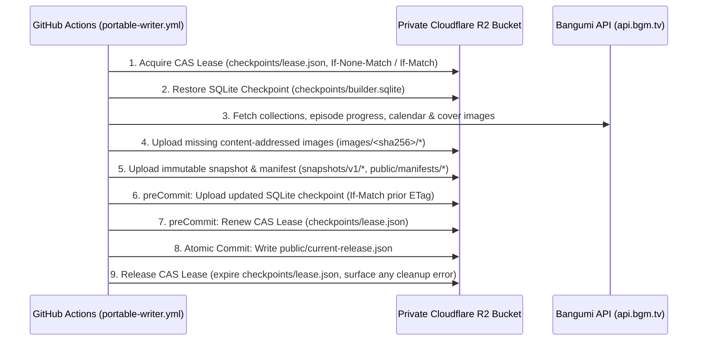

# AiringCal v3.0.0 — System Architecture & Security Model

AiringCal `v3.0.0` separates the **stateful Builder/Writer plane** from the **stateless edge Reader plane** over a single private Cloudflare R2 bucket per environment.

---

## 1. Architectural Principles

1. **Zero Cloudflare Worker Write Paths**: Cloudflare Workers never execute background cron writes, D1 writes, or KV writes. All synchronization runs out-of-band in the GitHub Actions Portable Writer (`.github/workflows/portable-writer.yml`).
2. **Single Private R2 Bucket per Environment**:
   - `production` → `airingcal-production`
   - `development` → `airingcal-development`
   - Public `r2.dev` bucket domains are disabled (`wrangler r2 bucket dev-url disable`).
3. **Immutable Content-Addressed Releases + Atomic Pointer Commit**:
   - Every published snapshot (`snapshots/v1/<generation>-<sha256>.json`), manifest (`public/manifests/<generation>-<sha256>.json`), and cover image (`images/<sha256>/{original,thumb.v1.webp,thumb.v2.webp}`) is content-addressed and immutable (`Cache-Control: public, max-age=31536000, immutable`).
   - Readers discover the active release through a single mutable pointer object (`public/current-release.json`, `Cache-Control: public, max-age=0, must-revalidate`).

---

## 2. Write Plane: Portable Builder & CAS Checkpoint Discipline

### Key Write Invariants

- **Compare-And-Swap (CAS) Single-Writer Lease (`checkpoints/lease.json`)**:
  - Acquired before restoring the SQLite checkpoint (`ttlSeconds = 2700`). If held by another active writer, the run fails closed immediately without touching the checkpoint or release pointer.
- **Deferred Pointer Commit (`publishPreCommit`)**:
  - All referenced cover images, thumbnails, snapshots, and the updated `checkpoints/builder.sqlite` (verified via `If-Match` against the restored ETag) are uploaded and the lease is renewed **before** `public/current-release.json` is written.
  - A reader can never observe a `current-release.json` pointer whose snapshot or cover images are not yet present in R2.
- **Explicit Lease Cleanup Surfacing**:
  - Lease release runs after every Writer invocation. If releasing `checkpoints/lease.json` fails due to an S3/R2 error, the Writer logs a structured `checkpoint_lease_release_failed` diagnostic with recovery instructions, attaches `leaseCleanup: { released: false, error, recoveryHint }`, marks the run failed so operators are notified via Bark/GitHub Actions, and preserves the primary sync summary.

---

## 3. Read Plane: Stateless Cloudflare Worker & In-Isolate Snapshot Cache

- **Entrypoint**: `apps/v3-read-worker/src/index.ts` → `packages/v3-read`.
- **R2 Binding**: Reads directly from `env.AIRINGCAL_R2` (`R2PublicStore`).
- **Verified Snapshot Cache (`packages/v3-read/src/verified-snapshot-cache.ts`)**:
  - Caches the parsed and SHA-256-verified snapshot in Worker isolate memory keyed by `(artifact_ref, expected_sha256)`.
  - Re-reads `public/current-release.json` with a short TTL so pointer roll-forwards take effect within seconds while avoiding repeated JSON parsing and digest verification on every request.
- **Allowlisted Public Object Interface (`packages/v3-read/src/public-object-routes.ts`)**:
  - Matches only `/public/current-release.json`, `/public/manifest.json`, `/public/manifests/<gen>-<sha256>.json`, `/snapshots/v1/<gen>-<sha256>.json`, and `/images/<sha256>/{original,thumb.v1.webp,thumb.v2.webp}`.
  - Every other key prefix (`checkpoints/**`, arbitrary keys, encoded slashes) falls through to `404` before any R2 read.

---

## 4. Monorepo Package Layout

| Workspace Package | Path | Responsibility |
| :--- | :--- | :--- |
| `@airing-cal/bgm-api` | `packages/bgm-api` | Typed Bangumi v0 HTTP client, pagination, retry, and full/incremental fetch assembly |
| `@airing-cal/domain` | `packages/domain` | Core domain rules, subject/episode normalization, and calendar projection |
| `@airing-cal/storage` | `packages/storage` | Snapshot v1 schemas, image hash keys, MIME sniffing (`sniffImage`), and shadow comparison types |
| `@airing-cal/v3-core` | `packages/v3-core` | Core ports (`PublicStore`, `ReleasePointer`), SHA-256 digest verification, and HTTP cache contracts |
| `@airing-cal/v3-builder` | `packages/v3-builder` | Native `node:sqlite` builder state store (`SqliteBuilderStateStore`), sync job runner, and checkpoint publisher |
| `@airing-cal/v3-read` | `packages/v3-read` | Portable HTTP read handlers, Cloudflare read handler, allowlisted object routes, and Node test server |
| `@airing-cal/v3-adapters` | `packages/v3-adapters` | Cloudflare R2 `PublicStore` adapter (`R2PublicStore`) and runtime capability registry |
| `@airing-cal/widget` | `packages/widget` | Preact + TypeScript frontend built with Vite into the Worker-served `bangumi.js` / `bangumi.css` (standalone shell + Embeddable Widget) |
| `@airing-cal/v3-read-worker` | `apps/v3-read-worker` | Cloudflare Worker entrypoint, Wrangler configuration, and local `wrangler dev` smoke suite |
| `@airing-cal/node-jobs` | `apps/node-jobs` | GitHub Actions Portable Writer CLI (`gha-portable-writer`), S3 CAS checkpoint store, media refresh, and Bark failure notifications |
