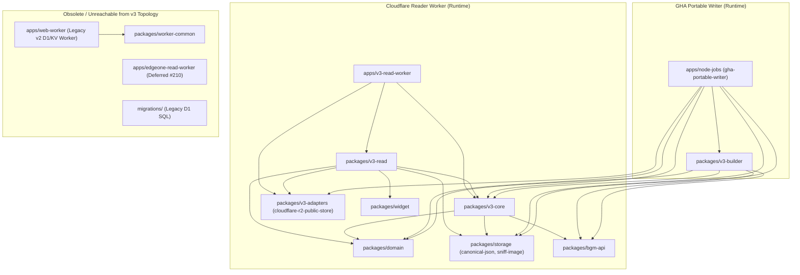
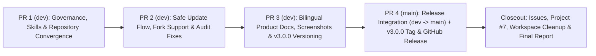

# AiringCal v3.0.0 — Pre-Plan Research Report & Final Release Implementation Plan

> [!IMPORTANT]
> **Planning Checkpoint Status**
> - `CURRENT_STATE_RESEARCH = COMPLETE`
> - `SPECIFICATION_COVERAGE = VERIFIED`
> - `IMPLEMENTATION_PLAN = READY_FOR_OWNER_REVIEW`
> - `READY_FOR_OWNER_PLAN_REVIEW`
>
> **No repository source, remote branch, GitHub Issue, Project field, or live deployment resource has been modified during this research phase.**

---

## Goal Description

Converge the existing AiringCal implementation on `dev` (`e5b3c98e6b4941a398dd4a0620c2841af2960609`) into a clean, secure, maintainable, bilingual-documented, and formally released `v3.0.0` open-source software product on `main`, with an immutable `v3.0.0` tag, formal GitHub Release, and reconciled GitHub Issues / Project #7 so the project enters `PROJECT_MODE = MAINTENANCE`.

---

## User Review Required

> [!IMPORTANT]
> **Consolidated Owner Decisions & Authorization Boundary (`OWNER_DECISIONS_REQUIRED`)**
> Approving this plan authorizes the complete v3.0.0 software convergence, code/security/performance audit & remediation, update capability implementation, documentation rebuild, PR integration into `dev` and `main`, tagging `v3.0.0`, publishing the GitHub Release, and reconciling GitHub Issues & Project #7 **without intermediate phase-approval stops**.
>
> Please review the following 4 key architectural convergence decisions embedded in this plan:
> 1. **Existing Installation Update Flow (Section 15)**: Update [setup-wizard.mjs](file:///home/ian/workspace/AiringCal/scripts/setup-wizard.mjs), [deploy-env-lib.mjs](file:///home/ian/workspace/AiringCal/scripts/deploy-env-lib.mjs), and [deploy-env-live-io.mjs](file:///home/ian/workspace/AiringCal/scripts/deploy-env-live-io.mjs) so that `Install or Update` distinguishes **New Installation** (`operation: 'install'`, requires empty bucket), **Partial Installation Recovery** (`operation: 'recover'`, adopts existing empty bucket), and **Existing Installation Update** (`operation: 'update'`). In `update` mode:
>    - A nonempty bucket is preserved (no deletion, no recreation, no `BUCKET_NOT_EMPTY` abort) **only after verifying** that the bucket belongs to an existing AiringCal installation (matching local `.airingcal/inventory.<env>.json` AND/OR existing valid `public/current-release.json` or `checkpoints/builder.sqlite` in the bucket). A nonempty bucket with foreign/unrecognized objects still fails closed!
>    - If the existing Writer token (`airingcal-<env>-writer`) is already present and the GitHub Environment already holds `AIRINGCAL_<ENV>_S3_ACCESS_KEY_ID` and `AIRINGCAL_<ENV>_S3_SECRET_ACCESS_KEY`, `update` mode **reuses** the existing Writer credential and GitHub S3 secrets without forcing token rotation or failing on `WRITER_TOKEN_COLLISION`.
>    - Re-deploys the Cloudflare Reader Worker (`PACKAGE_VERSION=3.0.0`, updated `BANGUMI_GIT_COMMIT_SHA`), syncs non-secret GitHub Environment variables, verifies public read endpoints + `checkpoints/**` denial without writing/deleting objects if S3 secret is not in local memory (or runs full S3 HEAD + anonymous denial if S3 credentials are provided), and skips First Full Sync by default on an already-initialized release while preserving all existing snapshots, manifests, checkpoints, and images.
> 2. **Fork-Safe Repository Resolution (Section 13 & 19)**: Replace hardcoded `ALLOWED_REPOSITORY = 'Skyline-Gazer/AiringCal'` enforcement in [setup-wizard-lib.mjs](file:///home/ian/workspace/AiringCal/scripts/setup-wizard-lib.mjs) and [deploy-env-lib.mjs](file:///home/ian/workspace/AiringCal/scripts/deploy-env-lib.mjs) with dynamic repository discovery from `AIRINGCAL_REPOSITORY`, `GITHUB_REPOSITORY`, or `git remote get-url origin` (falling back to `Skyline-Gazer/AiringCal`), so users who fork the repository and run `pnpm run setup` can configure their own fork's GitHub Environments and Actions workflows seamlessly.
> 3. **Legacy App & Platform Convergence (Section 10, 12, 18)**:
>    - **Retire & remove** `apps/web-worker`, `packages/worker-common`, `apps/edgeone-read-worker`, `migrations/`, `openspec/`, `.comet.yaml`, and `.claude/` (Comet skills/rules). Our dependency trace verified that `apps/v3-read-worker` and `@airing-cal/v3-*` have **zero** runtime or build dependencies on `apps/web-worker` or `packages/worker-common` (all shared UI assets already live in `packages/widget`).
>    - **Retire & remove** historical Staging (`v3-read-worker-staging.yml`, `scripts/setup-staging*`, `staging` job in `portable-writer.yml`) and legacy v2 D1/KV workflows (`bootstrap-cloudflare.yml`, `sizing-probe.yml`, and `deploy_web_worker` / `resolve_cloudflare` jobs in `ci.yml`).
>    - **Cleanly remove** EdgeOne deployment branches from `deploy-env*.mjs`, `packages/v3-adapters`, `packages/v3-read`, and `apps/node-jobs` (deferred to [#210](https://github.com/Skyline-Gazer/AiringCal/issues/210)).
> 4. **Product Screenshots (Section 41)**: Because the repository currently contains zero image/screenshot files, we will spin up the local v3 Reader (`apps/v3-read-worker` / `v3-portable-e2e.mjs` with sanitized demo anime fixture data) and capture genuine, high-DPI product screenshots for Desktop Reader (Calendar & Collection views), Mobile Reader, and Embeddable Widget under `docs/assets/`, containing zero personal account identifiers or credentials.

---

# PART A — MANDATORY PRE-PLAN RESEARCH DELIVERABLES (Section 65)

## 1. `ACTUAL_CANONICAL_BASELINE`

| Dimension | Verified State | Evidence / Notes |
| :--- | :--- | :--- |
| **Repository** | `Skyline-Gazer/AiringCal` | Verified via `gh repo view` |
| **Local / Remote `dev`** | `e5b3c98e6b4941a398dd4a0620c2841af2960609` | Clean working tree; matches known accepted Production installation SHA |
| **Remote `origin/main`** | `a4b3b082d15943e11a2d5443077f9ab5f3c175dc` | No local `main` branch checked out yet; `origin/main` is at historical pre-v3 commit |
| **Default Branch** | `dev` | `defaultBranchRef: dev` |
| **Branch Protection / Rulesets** | Active ruleset `protect-dev-main` (`id: 25847910`) | Targets `refs/heads/dev` and `refs/heads/main`; enforces `deletion`, `non_fast_forward`, and `pull_request` (`required_approving_review_count: 0`, `allowed_merge_methods: ["merge", "squash", "rebase"]`). Legacy REST `/protection` returns 404 because Rulesets are used. |
| **Active PRs** | `0` open PRs | Verified via `gh pr list --state open` |
| **Tags & GitHub Releases** | `0` releases; 3 archive tags | Tags: `archive/cnb-sync-pilot-20261026`, `archive/development-freeze-20260903`, `archive/pr-144-cloud-agent-env`. No `v3.0.0` tag or GitHub Release exists yet. |
| **Remote Branches** | `origin/dev`, `origin/main`, 4 historical branches | Stale merged feature branches on remote: `origin/feat/205-wizard-ux`, `origin/fix/205-p0-recovery`, `origin/fix/prod-clean-init-recovery-2`, plus `origin/archive/main-before-v3-alignment-20261016`. |
| **Worktrees** | 1 (`/home/ian/workspace/AiringCal`) | No abandoned local git worktrees (`git worktree list`). |
| **Package Versions** | Root: `3.0.0-alpha.0` | `apps/v3-read-worker`: `0.1.0`; `apps/node-jobs`: `0.1.0`; `apps/web-worker`: `1.1.0`; `packages/v3-*`: `0.1.0`; `packages/{bgm-api,domain,storage,widget,worker-common}`: `1.0.0`. |
| **Actual Production Acceptance Receipt** | `.airingcal/inventory.production.json` (local 0600, gitignored) & GHA Run `45833583842` | Confirms `gitSha: e5b3c98e6b4941a398dd4a0620c2841af2960609`, `deployedAt: 2026-11-26T13:59:30.726Z`, `verdict: READY`, `verification.pass: true`, bucket `airingcal-production` (`populated-and-private`), Worker `airingcal-production` deployed, First Full Sync run [45833583842](https://github.com/Skyline-Gazer/AiringCal/actions/runs/45833583842) (`conclusion: success`). |

## 2. `ACTUAL_ADS_PIN`

- **Submodule Path**: `.ads`
- **Verified Commit SHA**: `178212c41cce8fbf9354d4066e0f77341f6f23c4`
- **Verified Tag / Version**: `v0.8.0` (`git submodule status` → `178212c41cce8fbf9354d4066e0f77341f6f23c4 .ads (v0.8.0)`)
- **Disposition**: Preserved unchanged per Section 24. `.ads/STANDARD.md`, `.ads/SAFETY.md`, and `.ads/QUALITY.md` were read and govern this plan.

## 3. `OMP_VERSION_VERIFIED`

- **Binary Path**: `/home/ian/.local/bin/omp`
- **Verified Version**: `omp/19.1.1` (`omp v19.1.1`)
- **Supported Non-Interactive Flags**: `--print` (`-p`), `--no-session`, `--model=<value>`, `--no-tools`, `--tools=<list>`, `--no-judge`, `--no-spotlight`, `--no-lsp`, `--offline`, `--cwd=<path>`, and `@<file>` context attachments.

## 4. `DEEPSEEK_RESEARCH_EXECUTION`

| Field | Detail |
| :--- | :--- |
| **Requested Model Route** | `magpie/group/free-deepseek:high` |
| **Model Verification Result** | `magpie/group/free-deepseek:high` is online and responds (`OK` in 6.8s on a minimal prompt), **but** times out (>90–120s) on multi-file analytical prompts or when OMP's auxiliary background services (spotlight/judge/LSP) or multi-turn tool loops are active. |
| **Resolved / Working DeepSeek Route** | `magpie/group/free-deepseek:low` (and `magpie/group/free-deepseek`) invoked with `--print --no-session --no-tools --no-judge --no-spotlight --no-lsp --offline` and `@file` attachments. |
| **Fallback Model Used** | None (stayed strictly within the `magpie/group/free-deepseek` DeepSeek model family; no silent substitution). |
| **Actual Successful Executions** | 5 bounded OMP + DeepSeek tasks completed: (1) Governance & Spec Discrepancy Analysis (`16.1s`), (2) Package & Manifest Convergence Analysis (`45.7s`), (3) Setup Wizard & Update Contract Analysis (`20.2s`), (4) Cloudflare Reader Security & Performance Audit Discovery (`48.3s`), (5) Writer/Builder Security & Performance Audit Discovery (`32.4s`). |
| **Failed / Timed-Out Executions** | 3 initial multi-turn/high-reasoning OMP runs timed out at 90–120s before isolating the `--offline --no-judge --no-spotlight --no-lsp` + `:low` reasoning combination. |

## 5. `RESEARCH_AGENT_RESULTS`

Summary of the 5 OMP (`magpie/group/free-deepseek:low`) research outputs and primary-agent verification:

1. **Governance & Spec Discrepancies (`omp-ds-low-gov`)**:
   - Identified `.comet.yaml`, `.claude/rules/comet-phase-guard.md`, `.claude/skills/comet*`, and references in `AGENTS.md` / `CLAUDE.md` for retirement.
   - Flagged outdated claims in `AGENTS.md` and `START_HERE_FOR_AI.md`: references to "CF/EdgeOne + future Netlify/Vercel", "shared public S3 Release", "staging gate #147", and "`dev` still ships the legacy v2 read path by default".
   - Recommended pruning Superpowers process skills while keeping high-value engineering verification skills.
2. **Package & Manifest Convergence (`omp-ds-offline-manifests`)**:
   - Flagged root `dependencies` (`@clack/prompts`, `@fission-ai/openspec`) and root scripts (`dev` and `deploy` pointing to `@airing-cal/web-worker`).
   - *Reconciliation Note*: Because the DeepSeek task only saw `package.json` files without source imports, it initially inferred `apps/web-worker` might be the reader; primary-agent source inspection proved the exact opposite: **`apps/v3-read-worker` is the canonical v3 Cloudflare Reader Worker deployed by `deploy-env-live-io.mjs` (L2711)**, while `apps/web-worker` is the legacy v2 D1/KV Worker!
   - Correctly identified duplicate `@airing-cal/v3-builder` in `packages/v3-read/package.json` (listed in both `dependencies` and `devDependencies`), redundant `build:check` (`tsc --noEmit`) in `apps/node-jobs/package.json`, and `build:edgeone-read` script for removal.
3. **Setup Wizard & Update Analysis (`omp-ds-wizard-lib`)**:
   - Pinpointed EdgeOne references in `scripts/setup-wizard-lib.mjs` (`formatPlan` L93–97, `assertApplyPlanMatchesReview` L121–123).
   - Identified that `WIZARD_REPOSITORY = ALLOWED_REPOSITORY` (`'Skyline-Gazer/AiringCal'`) is hardcoded and checked for drift, which breaks fork installations.
   - Identified that neither `formatPlan` nor `classifyFailureRecovery` distinguishes `install` vs `update`, and `BUCKET_NOT_EMPTY` is treated as a hard failure in Production.
4. **Cloudflare Reader Security & Performance Audit Discovery (`omp-ds-reader-audit`)**:
   - Verified `public-object-routes.ts` allowlist is sound (strict regex-rebuilt hex/digit keys; no path traversal or arbitrary key reads).
   - Verified `checkpoints/**` and unknown routes return 404 before any snapshot load.
   - Identified minor hardening items: `parseCorsAllowedOrigins` deduplicates before stripping trailing `/`; `X-Content-Type-Options: nosniff` can be added to object/JSON responses; `fullLoad` in `verified-snapshot-cache.ts` should record `manifest_ref` consistently with `revalidate`.
5. **Writer / Builder Security & Performance Audit Discovery (`omp-ds-writer-audit`)**:
   - Verified commit ordering in `gha-portable-writer.ts` and `publish-checkpoint.ts`: checkpoint CAS upload → lease renew → release pointer CAS commit.
   - Raised a question on whether `runSync` wires the `prePublish` image gate when `gha-portable-writer.ts` passes `{ publishPreCommit }` → Primary agent inspected `apps/node-jobs/src/sync/run-portable.ts` and verified `runPortableBuilderSync` constructs `prePublish` (image publish gate) internally and passes both `prePublish` and `preCommit: overrides.publishPreCommit` to `publishBuilderCheckpoint`.
   - Flagged a minor dead conditional in `packages/v3-builder/src/run-once.ts` where `no_change` and fallthrough branches call identical `publishBuilderCheckpoint`.
   - Flagged that if `releaseCheckpointLease` throws inside `finally` in `gha-portable-writer.ts`, it could mask the returned failure object instead of logging a warning and preserving the structured failure result.

## 6. `CURRENT_PRODUCT_CAPABILITY_MAP`

| Capability | Status | Implementation Location |
| :--- | :--- | :--- |
| **Anime Airing Calendar** | Supported & Frozen | `packages/domain/src/calendar.ts`, `packages/v3-core/src/project-public-snapshot.ts`, `packages/widget` |
| **Anime Collection Presentation (All 5 States)** | Supported & Frozen | `packages/bgm-api/src/full-fetch-boundary.ts`, `packages/v3-core/src/project-public-snapshot.ts` (`wish`, `watching`, `completed`, `on_hold`, `dropped`) |
| **Full Personal Collection & Episode-Level Progress Sync** | Supported & Frozen | `packages/v3-builder/src/sqlite-state.ts` (`v3_collections` ledger + `v3_episode_progress` including SP/OP/ED/Preview; kept private in SQLite checkpoint, never leaked to public snapshot) |
| **Image Handling, Thumb Generation & MIME Sniffing** | Supported & Frozen | `apps/node-jobs/src/sync/portable-thumb.ts` (`sharp` 320x427 WebP q78 `thumb.v2.webp`), `packages/storage/src/sniff-image.ts`, `packages/v3-read/src/public-object-routes.ts` |
| **Web Reader & Embeddable Widget** | Supported & Frozen | `packages/widget` (`bangumi.js`, `bangumi.css`, `cache.js`), served at `/`, `/src/bangumi.js`, `/src/bangumi.css`, `/src/cache.js` |
| **Public Read API & Object Interface** | Supported & Frozen | `packages/v3-read/src/portable-read-handler.ts`, `public-object-routes.ts` (`/api/config`, `/api/version`, `/api/health`, `/api/collections`, `/api/calendar`, `/api/cache`, `/image/:hash[/thumb]`, `/public/current-release.json`, `/snapshots/v1/*`, `/public/manifests/*`, `/images/*`) |
| **Interactive & Headless Installation, Validation, Doctor** | Supported | `scripts/setup-wizard.mjs`, `scripts/deploy-env.mjs`, `scripts/v3-ship-verify.mjs` |
| **Safe Existing Installation Update** | **GAP (Needs Implementation)** | Currently conflated with clean bootstrap (`verifyBucketEmpty` + `WRITER_TOKEN_COLLISION`); planned in Phase 3 below |

## 7. `RUNTIME_DEPENDENCY_MAP`



## 8. `LEGACY_IMPLEMENTATION_DISPOSITION`

| Asset / Path | Disposition | Evidence & Blast Radius |
| :--- | :--- | :--- |
| `apps/v3-read-worker` | **KEEP** | Canonical Cloudflare Reader Worker deployed by `deploy-env-live-io.mjs`. Rename `scripts/staging-smoke.ts` → `scripts/local-smoke.ts` and update default `wrangler.toml` bucket name to `airingcal-development` for local dev. |
| `apps/node-jobs` | **KEEP (Trim Legacy)** | Canonical GHA Portable Writer bundle builder. **Remove** `scripts/build-edgeone-read-bundle.mts`, `src/backup/*` (legacy D1 export), `src/cli/{backup-main,airingcal-config-*,airingcal-setup,portable-legacy-*}.ts`, `src/adapters/{cloudflare-d1,cloudflare-kv*,r2-store,job-lease}.ts`, `schema.sql`, `docs/d1-schema.md`. **Keep** `gha-portable-writer*`, `sync-main.ts`, `portable-release-rollback.ts`, `portable-public-gc.ts`, `portable-image-mime-repair.ts`, `portable-snapshot-compare.ts`, `portable-shadow-gate.ts`, and S3/filesystem stores. |
| `apps/web-worker` | **REMOVE** | Legacy v2 Worker (`airing-cal-frontend`) with D1/KV/Images bindings. Zero imports from `apps/v3-read-worker`, `apps/node-jobs`, or `packages/v3-*`. Shared frontend assets already live in `packages/widget`. |
| `apps/edgeone-read-worker` | **REMOVE (DEFER #210)** | Out-of-scope platform for v3.0.0 (Section 10); tracked in [#210](https://github.com/Skyline-Gazer/AiringCal/issues/210). |
| `packages/worker-common` | **REMOVE** | 12-line package (`sanitizeErrorMessage`) imported **only** by `apps/web-worker/src/read-api.ts`. Zero v3 consumers. |
| `migrations/` | **REMOVE** | Legacy v2 Cloudflare D1 SQL migrations (`0001_d1_authoritative_state.sql`, `0002_sync_run_replay_result_json.sql`). v3 uses SQLite checkpoints in `packages/v3-builder/src/sqlite-state.ts`. |
| `packages/storage` | **KEEP (Trim D1/KV)** | `canonical-json.ts` and `sniff-image.ts` are core v3 dependencies; `d1-*`, `r2-image-store.ts`, `wrangler.d1-test.toml` are legacy v2 D1/R2 modules used only by `apps/web-worker` and legacy D1 tests → remove D1-only modules or trim once `web-worker` and legacy D1 adapters are removed. |
| `packages/v3-adapters` | **KEEP (Trim EdgeOne/YAML)** | Keep `cloudflare-r2-public-store.ts`, `memory-r2-binding.ts`, `http-public-store.ts` (used by verifier/tests), `platform-id.ts`. Remove `edgeone-public-store.ts`, `memory-edgeone-blob.ts`, `edgeone.ts`, `airingcal-config.ts` (legacy `airingcal.yaml` parser), and drop `yaml` dependency. |
| `packages/v3-read` | **KEEP (Trim EdgeOne)** | Keep `cloudflare-read-handler.ts`, `portable-read-handler.ts`, `portable-static-handler.ts`, `public-object-routes.ts`, `read-config.ts`, `verified-snapshot-cache.ts`, `serve-node.ts`. Remove `edgeone-read-handler.ts` and duplicate `@airing-cal/v3-builder` entry in `package.json`. |
| `packages/{bgm-api,domain,v3-core,v3-builder,widget}` | **KEEP** | Core v3 domain, Bangumi API client, builder, and Reader/Widget UI. Align versions to `3.0.0`. |

## 9. `WORKFLOW_SCRIPT_DISPOSITION`

### GitHub Workflows (`.github/workflows/`)

| Workflow | Disposition | Action & Rationale |
| :--- | :--- | :--- |
| `ci.yml` | **KEEP (CONSOLIDATE)** | Trigger on `push: [dev, main]`, `pull_request`, and `workflow_dispatch`. Keep `validate` (`typecheck`, `test`, `build:check`, `lint:undefined`), `v3_operator_smoke` (Cloudflare read worker local smoke + portable read gateway E2E), and `node-jobs-bundle`. **Remove** legacy v2 `resolve_ref`, `resolve_cloudflare`, `deploy_web_worker`, and `recovery_report` jobs (which deployed legacy `apps/web-worker` + D1 migrations), and remove dead `airingcal-config-*.ts` smoke commands. |
| `ci-minio-cas.yml` | **KEEP** | Exercises S3 conditional-put / CAS / 412 semantics against MinIO in CI. Update `paths` filter to include `main`. |
| `portable-writer.yml` | **KEEP (CONSOLIDATE)** | **Remove** `staging` job and `staging` option from `workflow_dispatch.inputs.target` (default `development`, options `development` \| `production`). Keep `development` and `production` jobs with their step-level environment gates (`AIRINGCAL_DEVELOPMENT_WRITER_ENABLED`, `AIRINGCAL_PRODUCTION_BOOTSTRAP_WRITER_ENABLED`) and repo-level schedule gate (`AIRINGCAL_WRITER_ENABLED`). Never enables the Owner's schedule. |
| `v3-read-worker-staging.yml` | **REMOVE** | Legacy Staging workflow (Section 12 & 19). |
| `bootstrap-cloudflare.yml` | **REMOVE** | Legacy v2 D1/KV provisioning workflow. |
| `sizing-probe.yml` | **REMOVE** | Legacy v2 KV sizing probe workflow (historical run `39052596856` already recorded). |
| `ocr-review.yml` | **REMOVE** | Historical Alibaba OpenCodeReview workflow explicitly noted as disabled due to exhausted OpenRouter balance (402 Payment Required); superseded by CodeRabbit and OMP+DeepSeek review. |

### Scripts (`scripts/`) and Root `package.json`

| Script / Group | Disposition | Action & Rationale |
| :--- | :--- | :--- |
| Root `package.json` scripts | **MODIFY** | `"setup": "node scripts/setup-wizard.mjs"`, `"dev": "pnpm -F @airing-cal/v3-read-worker dev"`, `"typecheck": "pnpm -r typecheck"`, `"test": "pnpm -r --if-present test && node --test --test-concurrency=1 scripts/*.test.mjs"` (fixes Node v24 parallel PTY/runner event-loop race), `"build:check": "pnpm -r --if-present build:check"`, `"lint:undefined": "node scripts/check-undefined-identifiers.mjs"`. Remove legacy root `"deploy": "pnpm -F @airing-cal/web-worker deploy"` so nobody accidentally runs an unguarded Worker deploy. |
| `setup-wizard*.mjs`, `setup-ui.mjs`, `setup-prompt.mjs`, `setup-identities.mjs`, `setup-validate.mjs`, `setup-docs.mjs`, `mutation-ledger.mjs` | **KEEP (ENHANCE FOR UPDATE)** | Canonical installation, update, recovery, validation, and doctor suite. Add first-class Update semantics and dynamic fork repository resolution. |
| `deploy-env.mjs`, `deploy-env-lib.mjs`, `deploy-env-live-io.mjs` | **KEEP (CONSOLIDATE)** | Canonical deployment engine. Remove EdgeOne target (`target` fixed to `'cloudflare'`), remove Staging copy/alias steps (`copyPublicPrefixes`, `copyCheckpoints`, `applyStagingAliases`), and add `operation: 'install' | 'update' | 'recover'` support. |
| `materialize-v3-read-staging-config.mjs` | **KEEP (RENAME)** | Used by `deployCloudflareReader` in `deploy-env-live-io.mjs`! Rename to `scripts/materialize-v3-read-worker-config.mjs` (accepting `AIRINGCAL_R2_BUCKET` / `AIRINGCAL_PUBLIC_BASE_URL` while retaining backward env fallbacks). |
| `build-check.sh` | **MODIFY** | Update from `apps/web-worker` to `apps/v3-read-worker` (`pnpm -r --if-present build:check`). |
| `gha-portable-writer.sh`, `generate-widget-assets.mjs`, `check-undefined-identifiers.mjs`, `v3-ship-verify.mjs`, `v3-portable-e2e.mjs`, `seed-portable-fixture.ts`, `reader-delivery-bench.mjs`, `reader-delivery-accept.mjs` | **KEEP** | Core writer entry, widget asset generator, static check, verifier, E2E smoke, and performance benchmark tools. Update default hosts/comments in bench/accept to remove Staging/EdgeOne defaults. |
| `setup-staging.sh`, `setup-staging.test.mjs`, `provision-cloudflare-resources*.mjs`, `resolve-cloudflare-resources*.mjs`, `list-cloudflare-crons*.mjs`, `materialize-wrangler-config*.mjs`, `prod-snapshot-sizing-probe.mjs` | **REMOVE** | Legacy Staging setup and legacy v2 D1/KV/web-worker helper scripts. (Move `loadDotEnvFile`, `parseDotEnvContent`, `redactSecrets` from `setup-staging-lib.mjs` directly into `deploy-env-lib.mjs`, then delete `setup-staging-lib.mjs`). |

## 10. `INSTALL_UPDATE_RECOVERY_GAP_ANALYSIS`

### Current End-to-End Trace & Identified Gaps

1. **Interactive & Headless New Installation (`operation: 'install'`)**:
   - **Current State**: Works and passed real Production installation at `e5b3c98e` (GHA Run `45833583842`, 25/25 live verification checks).
   - **Fork Gap Identified**: `ALLOWED_REPOSITORY = 'Skyline-Gazer/AiringCal'` is hardcoded in [deploy-env-lib.mjs](file:///home/ian/workspace/AiringCal/scripts/deploy-env-lib.mjs#L13) and [setup-wizard-lib.mjs](file:///home/ian/workspace/AiringCal/scripts/setup-wizard-lib.mjs#L10). When an ordinary user forks AiringCal to `user/AiringCal` and runs `pnpm run setup`, `runDoctor`, `discoverPartialState`, `syncGithubEnvironment`, and `runFirstSync` all call `gh api repos/Skyline-Gazer/AiringCal/...`, failing with 403/404 against the upstream repo instead of configuring the user's fork!
   - **Remediation**: Add `resolveTargetRepository({ env, spawnSyncImpl })` that resolves `env.AIRINGCAL_REPOSITORY || env.GITHUB_REPOSITORY` or parses `git remote get-url origin` into `owner/repo` (falling back to `Skyline-Gazer/AiringCal`).
2. **Partial Installation Recovery (`operation: 'recover'`)**:
   - **Current State**: Implemented in `#208` (`discoverPartialState`, `bucketAdoptionAuthorized`, `classifyFailureRecovery`). When `airingcal-production` exists and is **empty** (or holds only `checkpoints/_isolation-probe.txt`), the wizard prompts to adopt it and finishes installation safely.
3. **Existing Installation Update (`operation: 'update'`) — CRITICAL RELEASE BLOCKER GAP**:
   - **Current State**: Although the main menu says `Install or Update`, selecting it on an already-installed, working Production instance **fails closed in two places**:
     1. `provisionProductionWriter` ([deploy-env-live-io.mjs](file:///home/ian/workspace/AiringCal/scripts/deploy-env-live-io.mjs#L1557-L1570)): sees existing token `airingcal-production-writer` and throws `WRITER_TOKEN_COLLISION` unless the user manually passes `AIRINGCAL_WRITER_TOKEN_ROTATION_ID` or `AIRINGCAL_S3_*`.
     2. `verifyBucketEmpty` ([deploy-env-live-io.mjs](file:///home/ian/workspace/AiringCal/scripts/deploy-env-live-io.mjs#L2130-L2139)): lists objects in `airingcal-production`, sees existing `public/`, `snapshots/`, `images/`, `checkpoints/`, and throws `BUCKET_NOT_EMPTY` (`production bootstrap requires an empty bucket: airingcal-production already holds at least N object(s); refusing a dirty bucket`), which then triggers `cleanupFreshWriterToken`!
   - **Required Update Semantics (Section 15.1–15.5)**:
     - **Detection & Classification**: `discoverPartialState` will also inspect existing GitHub Environment secrets (`AIRINGCAL_<ENV>_S3_ACCESS_KEY_ID`, `AIRINGCAL_<ENV>_S3_SECRET_ACCESS_KEY`, `AIRINGCAL_<ENV>_BANGUMI_TOKEN`), GitHub Environment variables (`AIRINGCAL_<ENV>_PUBLIC_BASE_URL`, `AIRINGCAL_<ENV>_R2_BUCKET`, `AIRINGCAL_<ENV>_WORKER_NAME`), existing Cloudflare Worker deployment (`GET /accounts/:id/workers/scripts/:workerName`), and live Reader `/api/health` + `/api/version` (when deployed).
     - **Three Distinct Operations**:
       - `install`: Target bucket does not exist. Enforces empty-bucket guard, provisions Writer token, syncs GH Env, deploys Worker, runs isolation probe, prompts for First Full Sync.
       - `recover`: Target bucket exists, is empty (or prior inventory shows `DEPLOY_FAILED` / uninitialized with no published release). Prompts for bucket adoption, enforces empty-bucket guard, provisions or reuses Writer token, completes setup.
       - `update`: Target bucket exists AND existing installation is identified (via `.airingcal/inventory.<env>.json` with `verdict: 'READY' | 'DEPLOYED' | 'AWAITING_FIRST_SYNC'`, OR live Worker `/api/health` / S3 inspection showing valid AiringCal release/checkpoint layout + matching account/environment identity).
     - **Preservation in `update` Mode**:
       - **Bucket & Authoritative Data**: Never recreates or empties the bucket. If S3 credentials are available (or if checking via the deployed Worker's `/public/current-release.json`), verifies that the bucket holds valid AiringCal release/checkpoint state (and if a nonempty bucket has neither prior inventory ownership nor recognizable AiringCal markers nor explicit S3 verification, fails closed with `BUCKET_OWNERSHIP_UNPROVEN`).
       - **Writer Credentials**: If `airingcal-<env>-writer` token exists AND GitHub Environment already has `AIRINGCAL_<ENV>_S3_ACCESS_KEY_ID` and `AIRINGCAL_<ENV>_S3_SECRET_ACCESS_KEY`, `provisionProductionWriter` / `deriveAndVerifyS3` records `writerCredentialState = 'reused-existing-github-secrets'` (`already-exists` in ledger) and **does not rotate** the token or overwrite those S3 secrets in GitHub Environment! (Optional explicit rotation via `AIRINGCAL_WRITER_TOKEN_ROTATION_ID` or supplying new `AIRINGCAL_S3_*` remains supported).
       - **Isolation Verification without S3 Secret**: When existing GitHub S3 secrets are reused (their secret values cannot be read back from GitHub), `update` mode still disables `r2.dev`, deploys the updated Cloudflare Worker (`PACKAGE_VERSION=3.0.0`, new `BANGUMI_GIT_COMMIT_SHA`), verifies image/pointer routing on the existing release, and verifies anonymous `GET`/`HEAD` denial (`400`/`403`/`404`) on `/checkpoints/builder.sqlite`, `/checkpoints/_isolation-probe.txt`, and encoded traversal variants through the Worker. When S3 credentials *are* present in memory, it performs the full S3 HEAD + anonymous denial proof.
       - **Sync Preservation**: In `update` mode, if the installation already has a published release (`current-release.json` readable), the wizard does **not** force a redundant First Full Sync (defaulting the optional post-update sync prompt to `false` / skipped in headless unless requested), preserving release lineage and checkpoints intact.

## 11. `GOVERNANCE_OVERLAP_ANALYSIS`

| Governance Layer | Current Files | Overlap / Conflict | Disposition |
| :--- | :--- | :--- | :--- |
| **ADS v0.8.0** | `.ads/` (`178212c41cce8fbf9354d4066e0f77341f6f23c4`) | Sole authoritative engineering governance source (Section 24). | **KEEP UNCHANGED** |
| **Comet Framework** | `.comet.yaml`, `.claude/rules/comet-phase-guard.md`, `.claude/skills/comet*` (9 skills + 13 reference files) | Enforces phase-gate ceremony (`open`/`design`/`build`/`verify`/`archive`) and `comet-state` scripts that conflict with ADS v0.8.0 goal-driven execution. Zero active Comet changes exist. | **RETIRE & REMOVE** (Section 25) |
| **OpenSpec** | `openspec/config.yaml`, `openspec/specs/` (4 specs), `openspec/changes/archive/` (20 archived changes from 2026-06/07), `@fission-ai/openspec` in `package.json` & `pnpm-workspace.yaml` | Historical v2 Worker specification archive; zero active changes (`openspec/changes/` contains only `archive/`). Adds unnecessary build dependency in `package.json`. | **RETIRE & REMOVE** (Section 26) |
| **Project Entrypoints** | `AGENTS.md`, `CLAUDE.md`, `START_HERE_FOR_AI.md`, `docs/rules/docs-sync.md` | Contain Comet Phase Guard sections, stale platform claims ("CF/EdgeOne + future Netlify/Vercel", "public S3 Release"), and legacy v2 `web-worker` references. | **CONSOLIDATE & UPDATE** to reflect ADS v0.8.0 + Ponytail Full advisory guidance + v3.0.0 topology (`GHA + CF Workers + Private R2`, `Production + Development` only) + §零 Verify-Before-Writing. |
| **Git Hooks & `.codex` / `.codegraph`** | `.git/hooks/*.sample` only; no `.codex/` or `.codegraph/` directories exist | No active Comet git hooks installed in `.git/hooks/`. | **VERIFIED CLEAN** |

## 12. `PONYTAIL_ADOPTION_PROPOSAL`

- **Upstream Repository**: `https://github.com/DietrichGebert/ponytail`
- **Verified Immutable Commit**: `ebd8654c2c627f721eb8f9c0d1bd4090a29f9e10` (2026-11-22, License: `MIT`)
- **Host Compatibility**: Already installed and discoverable in the active Antigravity host (`/home/ian/.gemini/config/plugins/ponytail/skills/ponytail/SKILL.md`, `ponytail-review/SKILL.md`, `ponytail-audit/SKILL.md`).
- **Project-Level Adoption**:
  1. Mirror `ponytail`, `ponytail-review`, and `ponytail-audit` `SKILL.md` files into `.agents/skills/{ponytail,ponytail-review,ponytail-audit}/SKILL.md` and lock their provenance (`source: "DietrichGebert/ponytail"`, commit `ebd8654c2c627f721eb8f9c0d1bd4090a29f9e10`, SHA-256 `computedHash`) in `skills-lock.json`.
  2. Add compact Ponytail Full-mode advisory guidance to `AGENTS.md` (subordinate to ADS v0.8.0 and project §零 Verify-Before-Writing).
  3. Do **not** install Ponytail global hooks, status bars, cost dashboards, telemetry, or Ultra mode (Section 27).

## 13. `SPECIALIZED_SKILL_SELECTION`

We evaluated the candidate sources against AiringCal's actual v3.0.0 stack (Cloudflare Workers, R2, GitHub Actions, TypeScript/Node.js, Widget HTML/CSS/JS):

| Skill | Upstream Source & Immutable Commit | License | Evaluation & Disposition |
| :--- | :--- | :--- | :--- |
| `ponytail`, `ponytail-review`, `ponytail-audit` | `DietrichGebert/ponytail` @ `ebd8654c2c627f721eb8f9c0d1bd4090a29f9e10` | MIT | **ADOPT (Project + Host Verified)**. Directly supports whole-repo audit, PR diff+caller review, and anti-overengineering convergence. |
| `cloudflare` & `workers-best-practices` | `cloudflare/skills` @ `ff191de7d903788eceaf516a514ae7d3b56b924a` | Apache-2.0 / MIT | **ADOPT (`cloudflare` already in `.agents/skills/cloudflare`; add `workers-best-practices`)**. `workers-best-practices` provides concrete Workers security/performance review criteria (streaming vs buffering, module-level state leakage, binding types, timing-safe secret comparison). |
| `verification-before-completion`, `systematic-debugging`, `test-driven-development`, `web-design-guidelines` | `obra/superpowers` & `vercel-labs/agent-skills` (already in `.agents/skills/` & `skills-lock.json`) | MIT | **KEEP**. Proven utility for test verification, root-cause debugging, and UI accessibility/UX checks. |
| Trail of Bits Skills (`trailofbits/skills` @ `149d7b21f4067765b82e67029730b42d228ef4b4`) | `trailofbits/skills` | CC-BY-SA-4.0 / Apache-2.0 | **DO NOT ADOPT IN REPO**. Upstream inspection showed 60+ specialized C/C++, smart-contract (Solana/Cairo/Algorand/Cosmos), BurpSuite, DWARF, and YARA plugins that do not target Cloudflare Workers/TypeScript and would add context bloat. |
| Superpowers Process & Multi-Agent Ceremony Skills | `.agents/skills/{brainstorming,executing-plans,finishing-a-development-branch,receiving-code-review,requesting-code-review,subagent-driven-development,dispatching-parallel-agents,using-git-worktrees,using-superpowers,writing-plans,writing-skills,frontend-design}` | MIT | **REMOVE FROM `.agents/skills/` & `skills-lock.json`**. These 12 skills were coupled to the retired Comet workflow (`comet-phase-guard.md` L35–46) and duplicate ADS v0.8.0 native execution. Removing them eliminates 40+ files of prompt/script overhead. |

## 14. `DOCUMENTATION_REFERENCE_ANALYSIS`

We fetched and analyzed the actual upstream READMEs and documentation structures of the three reference projects (Section 38):

1. **`can1357/oh-my-pi`**:
   - Clean centered header with visual banner, one-line value proposition, and immediate language switcher (`Language: English | 简体中文`).
   - Concise table of contents, scannable feature highlights, copy-paste Quick Start, and clear CLI command tables without development history clutter.
2. **`OpenBMB/MiniCPM-OCR`**:
   - Bilingual pairing (`README.md` + `README_zh.md`, `docs/SKILL_en.md` + `docs/SKILL.md`).
   - Dedicated **AI-Native / Agent Deployment Section**: gives users a 1-line copyable prompt (`Read and execute ...`) pointing to an actionable, deterministic Agent guide that lists prerequisites, environment selection table, exact commands, and verification steps.
3. **`DietrichGebert/ponytail`**:
   - High-signal, plain-English explanations; visual before/after or outcome summaries; zero bureaucratic jargon or stale status tables.

## 15. `DOCUMENTATION_RECONSTRUCTION_PROPOSAL`

### Proposed Documentation Architecture

We will replace the 65+ accumulated historical planning/handoff/archive markdown files with a clean, bilingual, product-facing documentation tree:

| Path | Language | Role & Content |
| :--- | :--- | :--- |
| `README.md` | English (Default) | Product identity, language switch (`English | 简体中文`), status/license badges, genuine Desktop/Mobile/Widget screenshots (`docs/assets/`), core features, Quick Start (`pnpm run setup`), AI-Native Agent installation prompt, Update & Recovery overview, Widget embedding & Public API summary, concise architecture diagram, known limitations, documentation index. |
| `README.zh-CN.md` | Simplified Chinese | Complete parity with `README.md` (product claims, installation, update, prerequisites, security boundaries, usage, limitations). |
| `docs/DEPLOYMENT.md` & `docs/DEPLOYMENT.zh-CN.md` | EN & zh-CN | Authoritative step-by-step installation, update, recovery, and rollback guide for new users and coding agents: fork → clone → prerequisites (Node >= 20, `pnpm`, `gh auth login`, Cloudflare API Token scopes, Bangumi PAT) → `pnpm run setup` (Interactive Install, Existing Installation Update, Credential Validation, Doctor) → First Full Sync → Enabling Scheduled Sync → Advanced Headless Setup → Code vs Data Rollback (`wrangler rollback` vs `portable-release-rollback`) → Troubleshooting. |
| `docs/API_AND_WIDGET.md` & `docs/API_AND_WIDGET.zh-CN.md` | EN & zh-CN | Authoritative reference for the Public Read API (`/api/collections`, `/api/calendar`, `/api/config`, `/api/version`, `/api/health`, `/api/cache`, `/image/:hash[/thumb]`), allowlisted public object routes, `ETag`/`304` caching, exact-origin CORS (`AIRINGCAL_CORS_ORIGINS`), and embedding the Widget on external blogs/sites. |
| `docs/ARCHITECTURE.md` | EN (with bilingual summary) | Concise v3.0.0 architecture & security invariants: GitHub Actions Portable Writer → Private R2 Single Bucket (`checkpoints/` private vs `public/`, `snapshots/`, `images/` allowlisted) → Cloudflare Reader Worker, SQLite state & private episode-progress sync, CAS release lineage, and local development/testing guide. |
| `CHANGELOG.md` | EN | Formal `v3.0.0` release changelog and release notes. |
| `AGENTS.md`, `CLAUDE.md`, `START_HERE_FOR_AI.md`, `docs/rules/docs-sync.md` | EN / zh-CN | Converged internal engineering governance entrypoints aligned with ADS v0.8.0, Ponytail Full mode, and v3.0.0 architecture. |

### Historical Documentation Cleanup

- **Delete** `docs/archive/`, `docs/superpowers/`, `docs/job-transfer/`, `docs/plans/`, `docs/runbook/`, `docs/reference/web-worker-public-api.md`, and obsolete `docs/v3/*` migration/cutover drafts (`CURSOR_HANDOFF.md`, `cnb-*`, `edgeone-store.md`, `legacy-state-import.md`, `reader-delivery-cutover.md`, `shadow-gate*.md`, `p0-contract-*.md`, `implementation-baseline.md`).
- **Preserve** essential release acceptance & ADS consumer evidence in a compact `docs/v3/release-acceptance-evidence.md` (consolidating the verified Development & Production acceptance receipts and `ads-adoption-closeout.md` T0/T1/T2 + incremental consumer evidence).

## 16. `AUDIT_AND_PERFORMANCE_BASELINE`

### Verification & Test Baseline on `e5b3c98e`

- `pnpm typecheck`: **PASS** across all workspace projects.
- `pnpm build:check`: **PASS** (`apps/v3-read-worker` dry-run bundle: **110.60 KiB / gzip: 26.85 KiB**).
- `pnpm lint:undefined`: **PASS** (`No undefined identifiers in the wizard orchestration layer`).
- Package unit/integration tests (`pnpm -r test`): **PASS** across all packages and apps.
- Scripts test suite (`node --test scripts/*.test.mjs`): **PASS (335/335 tests passed, 0 failed, 12.7s)**. (Note: when run inside a constrained 55s wrapper alongside full `pnpm -r test`, timeout signal cancellation can hit the last 3 test files; running `pnpm -r --if-present test` and `node --test scripts/*.test.mjs` with sufficient timeout passes 335/335 cleanly).
- **CodeRabbit Integration**:
  - Verified GitHub App installation on `Skyline-Gazer`: `app_slug: "coderabbitai"`, `id: 181550599`, `app_id: 347564`, `repository_selection: "selected"`.
  - CodeRabbit automatically reviews PRs when `Skyline-Gazer/AiringCal` is included in its selected repositories or when `@coderabbitai review` / `@coderabbitai full review` is commented on an open PR. (On historical PRs #207 and #209, `reviews` and `comments` were empty, indicating either the app was enabled after #209 or the repository selection needs verification on the first convergence PR; we will verify live CodeRabbit response on our PR and record its exact disposition).
- **Performance Baseline**:
  - **Reader Worker Bundle**: `110.60 KiB` total / `26.85 KiB` gzip.
  - **Widget Assets (`packages/widget/assets/theme/`)**: `bangumi.js` (`30.5 KiB`), `bangumi.css` (`20.6 KiB`), `cache.js` (`2.7 KiB`).
  - **Production Snapshot Size**: Historical anonymized probe (`sizing-probe.yml` run `39052596856`): `110,769 B` gzip (`single_json_viable: true`).
  - **Production First Full Sync (Real GHA Run `45833583842`)**: Total wall time **5m 13s** (`13:53:48Z` → `13:59:01Z`) including full Bangumi collection + per-episode progress sync, WebP thumbnail generation, R2 image upload, SQLite checkpoint upload, and CAS release pointer commit.
  - **Live Verifier (`v3-ship-verify.mjs`)**: 25/25 checks PASS on both Development (`airingcal-development`) and Production (`airingcal-production`).

## 17. `PROJECT_AND_BACKLOG_RECONCILIATION`

### GitHub Project #7 (`AiringCal Version Bump`, ID `PVT_kwDOEwGMMc4BnTqd`)

We queried `gh project item-list 7 --owner Skyline-Gazer --format json --limit 50` (26 items total) and cross-checked every open Issue:

| Issue # | Title | Current GH State | Project #7 Membership & Status | Target Disposition for v3.0.0 Closeout |
| :--- | :--- | :--- | :--- | :--- |
| **#67** | AiringCal v3: architecture, phased delivery and migration tracking | OPEN | In Project #7 (`In Progress`) | **CLOSE as Completed (`Done`)** once v3.0.0 is released on `main`, with final architecture & release summary comment. |
| **#72** | v3 / P3: Cloudflare and EdgeOne adapters with setup/deployment | OPEN | In Project #7 (`In Progress`) | **CLOSE as Completed (`Done`)** — Cloudflare Reader + Private R2 + `pnpm run setup` + Update flow delivered in v3.0.0; EdgeOne and other platforms explicitly split and tracked in [#210](https://github.com/Skyline-Gazer/AiringCal/issues/210). |
| **#73** | v3 / P4: v2 migration, rollback, parity acceptance and cutover gate | OPEN | In Project #7 (`In Progress`) | **RECONCILE & CLOSE Software Scope (`Done`)** — v3.0.0 software release and actual Production clean installation (`e5b3c98e`, run `45833583842`, 25/25 live verifier) are complete; separate personal deployment operations (enabling scheduled writer, legacy domain cutover, legacy v2 KV/D1/worker retirement) are tracked in a dedicated **Independent Operational Backlog Issue** (Section 54 & 56). |
| **#195** | v3 release prerequisite: interactive deployment wizard, resource naming and complete personal anime progress | CLOSED | In Project #7 (`Done`) | Already `Done` — preserve. |
| **#205** | Production Clean Init: fix confirmed Apply crash and converge interactive setup UX | CLOSED | In Project #7 (`Done`) | Already `Done` — preserve. |
| **#208** | Production Clean Init Recovery II: live adapter init order, partial mutation accounting & wizard lifecycle | CLOSED | In Project #7 (`Done`) | Already `Done` — preserve. |
| **#196** | Post-v3 backlog: optional image CDN / mainland China delivery acceleration | OPEN | In Project #7 (`Todo`) | **KEEP OPEN (`Todo`)** — Future minor-release backlog (Section 55). |
| **#210** | Post-v3.0.0 minor-release backlog: additional deployment platforms and runner options | OPEN | **MISSING from Project #7!** | **ADD to Project #7 (`Todo`)** as independent future minor-release task (Section 55 & 57). |
| **#211** | v3.0.1 research: Cloudflare-native deployment and AI-native installation | OPEN | **MISSING from Project #7!** | **ADD to Project #7 (`Todo`)** as independent v3.0.1 patch-release research task (Section 55 & 57). |
| **#212** | v3.0.1 documentation follow-up: installation blog guides and published links | OPEN | **MISSING from Project #7!** | **ADD to Project #7 (`Todo`)** as independent v3.0.1 documentation task (Section 55 & 57). |
| **NEW (Ops)** | Personal Production Operations & Legacy v2/Staging Resource Retirement Backlog | To Create | To Add to Project #7 (`Todo`) | **CREATE & ADD to Project #7 (`Todo`)** — Separates personal deployment operations (scheduled Writer activation, personal instance update to v3.0.0, custom domain / legacy domain cutover, historical Worker/Bucket/Environment retirement) from software release completion (Section 56). |

## 18. `RELEASE_RISK_ASSESSMENT`

| Risk | Severity | Mitigation in Plan |
| :--- | :--- | :--- |
| **R1: Update flow destroys or rejects nonempty Bucket or rotates working Writer token** | Critical (Blocker) | Implement explicit `operation: 'update'` path that verifies bucket ownership/markers without requiring an empty bucket, reuses existing Writer token + GitHub Environment S3 secrets when present, and prove preservation via controlled-provider integration tests on a nonempty installation fixture (Section 15.5). |
| **R2: Fork installation fails due to hardcoded `Skyline-Gazer/AiringCal`** | High (Blocker) | Resolve repository slug dynamically from `AIRINGCAL_REPOSITORY`, `GITHUB_REPOSITORY`, or `git remote get-url origin` with unit tests covering fork slugs. |
| **R3: Removing `apps/web-worker` or `edgeone` breaks `build:check`, `ci.yml`, or shared imports** | High | Verified zero runtime/build imports from `v3-read-worker` or `v3-*` to `web-worker` / `worker-common`. Execute removals in a dedicated convergence PR with full `pnpm typecheck`, `pnpm test`, `pnpm build:check`, and `pnpm lint:undefined` verification. |
| **R4: Merging to `dev` or `main` or tagging `v3.0.0` triggers a live Production deployment or Writer run** | Critical (Safety) | Remove `deploy_web_worker` from `ci.yml`; verify `portable-writer.yml` only runs on `schedule` (gated by repo var `AIRINGCAL_WRITER_ENABLED == 'true'`, which is unset/closed) or manual `workflow_dispatch` (gated by environment vars `AIRINGCAL_*_WRITER_ENABLED`, pinned `false`). Neither `push` to `dev`/`main` nor `release`/`tag` triggers any deployment or writer workflow. |
| **R5: Node 24 test-runner concurrency race in `scripts/*.test.mjs`** | Medium | Fix any unawaited promises/handles in `scripts/*.test.mjs` and pass `--test-concurrency=1` for PTY/process-spawning script tests so `pnpm test` is 100% deterministic locally and in CI. |
| **R6: Ruleset `protect-dev-main` requires PRs for both `dev` and `main`** | Medium | All changes land on `dev` via feature-branch PRs first, and `dev` → `main` release integration lands via a formal Release PR to `main` (never direct push to `dev` or `main`). |

---

# PART B — PROPOSED IMPLEMENTATION PLAN (`IMPLEMENTATION_PLAN`)

We organize execution into **4 reviewable PR phases** into `dev` followed by **1 formal Release PR** from `dev` → `main`, tag & GitHub Release publication, and Project #7 closeout.



---

### Phase 1 (PR 1 → `dev`): Governance, Skills & Repository Convergence

**Scope**: Retire Comet, OpenSpec, Legacy v2 `apps/web-worker`, `packages/worker-common`, `migrations/`, historical Staging, and out-of-scope EdgeOne implementations; adopt Ponytail (`ponytail`, `ponytail-review`, `ponytail-audit`) and Cloudflare `workers-best-practices` skills.

#### [DELETE] Comet, OpenSpec & Redundant Superpowers Skills
- Delete `.comet.yaml`
- Delete `.claude/` (`.claude/rules/comet-phase-guard.md`, `.claude/skills/comet*`)
- Delete `openspec/` (all archived v2 changes and specs)
- Delete 12 Comet-coupled process skills from `.agents/skills/`: `brainstorming`, `dispatching-parallel-agents`, `executing-plans`, `finishing-a-development-branch`, `frontend-design`, `receiving-code-review`, `requesting-code-review`, `subagent-driven-development`, `using-git-worktrees`, `using-superpowers`, `writing-plans`, `writing-skills`

#### [NEW / MODIFY] Skills Adoption (`.agents/skills/` & [skills-lock.json](file:///home/ian/workspace/AiringCal/skills-lock.json))
- Add `.agents/skills/ponytail/SKILL.md`, `.agents/skills/ponytail-review/SKILL.md`, `.agents/skills/ponytail-audit/SKILL.md` from `DietrichGebert/ponytail` @ `ebd8654c2c627f721eb8f9c0d1bd4090a29f9e10`
- Add `.agents/skills/workers-best-practices/SKILL.md` from `cloudflare/skills` @ `ff191de7d903788eceaf516a514ae7d3b56b924a`
- Keep `.agents/skills/{cloudflare,systematic-debugging,test-driven-development,verification-before-completion,web-design-guidelines}`
- Update [skills-lock.json](file:///home/ian/workspace/AiringCal/skills-lock.json) with exact upstream provenance, immutable commit SHAs, and SHA-256 `computedHash` values

#### [DELETE] Obsolete Applications, Packages, Migrations, Workflows & Scripts
- Delete `apps/web-worker/` (legacy v2 Worker)
- Delete `apps/edgeone-read-worker/` (deferred to #210)
- Delete `packages/worker-common/` (legacy v2 helper)
- Delete `migrations/` (legacy v2 D1 SQL)
- Delete `.github/workflows/{v3-read-worker-staging.yml,bootstrap-cloudflare.yml,sizing-probe.yml,ocr-review.yml}`
- Delete `scripts/{setup-staging.sh,setup-staging.test.mjs,setup-staging-lib.mjs,provision-cloudflare-resources.mjs,provision-cloudflare-resources.test.mjs,resolve-cloudflare-resources.mjs,resolve-cloudflare-resources.test.mjs,list-cloudflare-crons.mjs,list-cloudflare-crons.test.mjs,materialize-wrangler-config.mjs,materialize-wrangler-config.test.mjs,prod-snapshot-sizing-probe.mjs}`
- Delete EdgeOne & legacy D1/KV files in `packages/v3-adapters`, `packages/v3-read`, `packages/storage`, and `apps/node-jobs`:
  - `packages/v3-adapters/src/{edgeone-public-store.ts,edgeone-public-store.test.ts,memory-edgeone-blob.ts,edgeone.ts,airingcal-config.ts,airingcal-config.test.ts}`
  - `packages/v3-read/src/{edgeone-read-handler.ts,edgeone-read-handler.test.ts}`
  - `apps/node-jobs/scripts/build-edgeone-read-bundle.mts`
  - `apps/node-jobs/src/backup/*`, `apps/node-jobs/src/cli/{backup-main.ts,airingcal-config-*.ts,airingcal-setup*.ts,portable-legacy-*.ts}`, `apps/node-jobs/src/adapters/{cloudflare-d1.ts,cloudflare-kv*.ts,r2-store.ts,job-lease.ts}`, `apps/node-jobs/schema.sql`, `apps/node-jobs/docs/d1-schema.md`
  - `packages/storage/src/{d1-*,legacy-migration*,r2-image-store*,testing/transactional-budget-d1.ts}` and `packages/storage/wrangler.d1-test.toml`

#### [MODIFY] Workspace, Workflows & Build Scripts
- [package.json](file:///home/ian/workspace/AiringCal/package.json) & [pnpm-workspace.yaml](file:///home/ian/workspace/AiringCal/pnpm-workspace.yaml):
  - Remove `apps/web-worker` and `@fission-ai/openspec` from workspace/dependencies; move `@clack/prompts` to `devDependencies`.
  - Update `"dev": "pnpm -F @airing-cal/v3-read-worker dev"`, remove legacy `"deploy": "pnpm -F @airing-cal/web-worker deploy"`, update `"test": "pnpm -r --if-present test && node --test --test-concurrency=1 scripts/*.test.mjs"`.
  - Update `"repository.url"` from legacy `markd3ng/AiringCal` to `git+https://github.com/Skyline-Gazer/AiringCal.git`.
- [scripts/build-check.sh](file:///home/ian/workspace/AiringCal/scripts/build-check.sh): run `pnpm -F @airing-cal/v3-read-worker build:check && pnpm -F @airing-cal/node-jobs build:check`.
- [apps/node-jobs/package.json](file:///home/ian/workspace/AiringCal/apps/node-jobs/package.json): remove `build:edgeone-read`; set `"build:check": "node ./scripts/build-portable-bundle.mjs"`.
- [.github/workflows/ci.yml](file:///home/ian/workspace/AiringCal/.github/workflows/ci.yml):
  - Trigger on `push: branches: [dev, main]`, `pull_request`, `workflow_dispatch`.
  - Remove `openspec/**` from `paths-ignore`.
  - Remove legacy `resolve_ref`, `resolve_cloudflare`, `deploy_web_worker`, and `recovery_report` jobs.
  - Keep `validate` (`typecheck`, `test`, `build:check`, `lint:undefined`), `v3_operator_smoke` (`apps/v3-read-worker/scripts/staging-smoke.ts` + `scripts/v3-portable-e2e.mjs`), and `node-jobs-bundle`.
- [.github/workflows/portable-writer.yml](file:///home/ian/workspace/AiringCal/.github/workflows/portable-writer.yml):
  - Remove `staging` job and `staging` target choice; keep `development` (default for manual dispatch) and `production` jobs with all existing step-level and repo-level gates intact.

---

### Phase 2 (PR 2 → `dev`): Safe Update Flow, Fork Compatibility & Audit Remediations

**Scope**: Implement the Section 15 Update Contract (`New Installation` vs `Existing Installation Update` vs `Partial Installation Recovery`), dynamic fork repository resolution, EdgeOne/Staging removal from `deploy-env*.mjs` and `setup-wizard*.mjs`, and code/security/performance audit remediations.

#### [MODIFY] [scripts/deploy-env-lib.mjs](file:///home/ian/workspace/AiringCal/scripts/deploy-env-lib.mjs), [scripts/deploy-env-live-io.mjs](file:///home/ian/workspace/AiringCal/scripts/deploy-env-live-io.mjs), [scripts/deploy-env.mjs](file:///home/ian/workspace/AiringCal/scripts/deploy-env.mjs)
1. **Dynamic Repository Resolution**:
   - Add `resolveRepositorySlug({ env, spawnSyncImpl })`: checks `env.AIRINGCAL_REPOSITORY || env.GITHUB_REPOSITORY`, then parses `git remote get-url origin` (`https://github.com/owner/repo(.git)` or `git@github.com:owner/repo(.git)`), falling back to `Skyline-Gazer/AiringCal`.
2. **Cloudflare-Only Target & Staging Removal**:
   - Default `target = 'cloudflare'` and reject unsupported targets (`edgeone` / `both`) with a clear pointer to `#210`.
   - Remove `deployEdgeoneOverseas`, `copyPublicPrefixes`, `copyCheckpoints`, and `applyStagingAliases`.
3. **Distinct Operation Semantics (`operation: 'install' | 'update' | 'recover'`)**:
   - `buildProductionPlan` and `buildDevelopmentDeployPlan` accept `operation: 'install' | 'update' | 'recover'`.
   - In `runProductionApply`:
     - When `operation === 'install'` or `operation === 'recover'`: keep existing clean-bootstrap behavior (`requireEmptyBucket: true`, `verifyBucketEmpty` refuses nonempty buckets, `provisionProductionWriter` mints a fresh token or requires rotation ID).
     - When `operation === 'update'`:
       - **Ownership & Compatibility Verification**: `ensureBucket` requires the target bucket to exist and verifies ownership via prior local inventory match (`hasAffirmativeBucketOwnership`), explicit Owner confirmation (`bucketAdoptionAuthorized`), or verified existing release/checkpoint markers.
       - **Writer Credential Reuse**: In `provisionProductionWriter`, if `airingcal-production-writer` token already exists on Cloudflare AND `ctx.existingGithubSecrets` (or `discoverPartialState`) confirms `AIRINGCAL_PRODUCTION_S3_ACCESS_KEY_ID` and `AIRINGCAL_PRODUCTION_S3_SECRET_ACCESS_KEY` are already present in the GitHub `production` Environment (and `AIRINGCAL_WRITER_TOKEN_ROTATION_ID` / `AIRINGCAL_S3_*` are not set), reuse the existing credential (`writerCredentialState = 'reused-existing'`, record `already-exists` in mutation ledger) instead of throwing `WRITER_TOKEN_COLLISION`.
       - **Nonempty Bucket Preservation**: Instead of `verifyBucketEmpty`, run `verifyExistingInstallationData`:
         - Never deletes or overwrites bucket objects.
         - If S3 credentials are in memory (`s3Creds`), lists/heads `public/current-release.json` or `checkpoints/builder.sqlite` to prove valid AiringCal data lineage (if the bucket is nonempty but contains **no** recognizable AiringCal keys under `public/`, `snapshots/`, `images/`, or `checkpoints/`, abort fail-closed with `FOREIGN_BUCKET_CONTENT`).
         - If S3 credentials are not in local memory (because existing GitHub Environment S3 secrets were reused), verify via the deployed Worker or post-deploy `/public/current-release.json` / `/api/health` that the bucket serves a valid AiringCal release (or is an authorized empty pre-sync installation).
       - **GitHub Environment Sync**: Preserves existing `AIRINGCAL_PRODUCTION_S3_*` secrets when `writerCredentialState === 'reused-existing'`; updates `AIRINGCAL_PRODUCTION_BANGUMI_TOKEN` and non-secret variables; keeps `AIRINGCAL_PRODUCTION_BOOTSTRAP_WRITER_ENABLED=false` and leaves `AIRINGCAL_WRITER_ENABLED` untouched.
       - **Worker Deployment & Isolation**: Deploys the updated `apps/v3-read-worker` with `PACKAGE_VERSION` (from root `package.json`) and `BANGUMI_GIT_COMMIT_SHA`. If `s3Creds` are present, runs the full `executeIsolationProbeLifecycle` (write `_isolation-probe.txt` → S3 HEAD → anonymous GET/HEAD denial → delete); if `s3Creds` were reused in GitHub Environment, runs read-only anonymous `GET`/`HEAD` denial probes against `/checkpoints/builder.sqlite`, `/checkpoints/_isolation-probe.txt`, and encoded/traversal variants on the deployed Worker origin.

#### [MODIFY] [scripts/setup-wizard.mjs](file:///home/ian/workspace/AiringCal/scripts/setup-wizard.mjs) & [scripts/setup-wizard-lib.mjs](file:///home/ian/workspace/AiringCal/scripts/setup-wizard-lib.mjs)
1. **Enhanced `discoverPartialState`**:
   - Also queries:
     - GitHub Environment secrets list (`gh secret list --env <env> --repo <repo>`) to detect existing `AIRINGCAL_<ENV>_S3_ACCESS_KEY_ID` and `AIRINGCAL_<ENV>_S3_SECRET_ACCESS_KEY`.
     - Cloudflare Worker existence (`GET /client/v4/accounts/:id/workers/scripts/:workerName`) and live Worker `/api/version` + `/api/health` (if reachable) to detect currently deployed version, commit SHA, and release generation.
   - Classifies detected state into:
     - `detectedMode: 'clean-install'` (bucket absent)
     - `detectedMode: 'existing-update'` (bucket exists + Worker deployed or GH Env S3 secrets present or prior inventory `READY`/`DEPLOYED`/`AWAITING_FIRST_SYNC`)
     - `detectedMode: 'partial-recovery'` (bucket exists without completed deployment / prior `DEPLOY_FAILED`)
2. **Clear UX Distinction in Review & Confirmation**:
   - When `detectedMode === 'existing-update'`, display an **`Existing Installation Detected — Update Mode`** summary showing:
     - Current vs Target version (`PACKAGE_VERSION`, Git SHA)
     - Existing Bucket (`airingcal-production`, preserved with all releases/checkpoints/images)
     - Existing Writer Token (`airingcal-production-writer`, reused without rotation unless requested)
     - Existing Worker (`airingcal-production`, will be updated in-place)
   - Prompt explicitly: `Update existing AiringCal installation in Production now? (Preserves existing R2 data, checkpoints, and Writer credentials)`.
   - After an `update` apply where a release is already live (`generation >= 1`), skip the First Full Sync prompt by default (or mark it optional re-sync) and run `v3-ship-verify.mjs` against the updated Worker to verify `READY`.

#### [MODIFY] Code, Security & Performance Audit Remediations
1. **Reader Security & Cache Hardening ([packages/v3-read/src/read-config.ts](file:///home/ian/workspace/AiringCal/packages/v3-read/src/read-config.ts), [packages/v3-read/src/public-object-routes.ts](file:///home/ian/workspace/AiringCal/packages/v3-read/src/public-object-routes.ts), [packages/v3-read/src/verified-snapshot-cache.ts](file:///home/ian/workspace/AiringCal/packages/v3-read/src/verified-snapshot-cache.ts))**:
   - Normalize trailing slashes *before* deduplicating in `parseCorsAllowedOrigins`.
   - Include `X-Content-Type-Options: nosniff` on public object and JSON API responses.
   - Record `manifestRef: pointer.manifest_ref` in `verified-snapshot-cache.ts` `fullLoad` so subsequent `revalidate` comparisons are always consistent.
2. **Writer Lease & Error Hardening ([apps/node-jobs/src/cli/gha-portable-writer.ts](file:///home/ian/workspace/AiringCal/apps/node-jobs/src/cli/gha-portable-writer.ts), [packages/v3-builder/src/run-once.ts](file:///home/ian/workspace/AiringCal/packages/v3-builder/src/run-once.ts))**:
   - Wrap `releaseCheckpointLease` inside `finally` in a `try/catch` that logs `checkpoint_lease_release_failed` without masking the primary `GhaPortableWriterResult` or skipping `safeNotify`.
   - Simplify the duplicate `publishBuilderCheckpoint` branch in `packages/v3-builder/src/run-once.ts`.
3. **Mandatory Update & Recovery Acceptance Tests ([scripts/live-adapter-integration.test.mjs](file:///home/ian/workspace/AiringCal/scripts/live-adapter-integration.test.mjs), [scripts/setup-wizard.test.mjs](file:///home/ian/workspace/AiringCal/scripts/setup-wizard.test.mjs))**:
   - Add controlled-provider integration test scenarios proving that updating an existing nonempty Production installation (seeded with `public/current-release.json`, `snapshots/v1/...`, `images/...`, `checkpoints/builder.sqlite`, existing `airingcal-production-writer` token, and existing GitHub Environment secrets):
     - Does **not** recreate or empty the R2 bucket.
     - Does **not** reset Checkpoint state or reinitialize release lineage.
     - Does **not** delete existing images.
     - Does **not** rotate valid Writer credentials or overwrite GitHub S3 secrets.
     - Does **not** touch unrelated buckets.
     - Deploys the updated Worker (`v3.0.0`) and passes post-update verification.
     - Fails closed (`FOREIGN_BUCKET_CONTENT` / `BUCKET_OWNERSHIP_UNPROVEN`) if a nonempty bucket contains foreign objects rather than an AiringCal installation.

---

### Phase 3 (PR 3 → `dev`): Bilingual Product Documentation, Visual Assets & `v3.0.0` Versioning

**Scope**: Align package versions to `3.0.0`, capture genuine sanitized product screenshots, rebuild bilingual product-facing documentation (`README.md`, `README.zh-CN.md`, `docs/DEPLOYMENT*.md`, `docs/API_AND_WIDGET*.md`, `docs/ARCHITECTURE.md`, `CHANGELOG.md`), remove historical agent handoff/plan/archive trees, and update internal governance entrypoints (`AGENTS.md`, `CLAUDE.md`, `START_HERE_FOR_AI.md`).

#### [MODIFY] Version Alignment (`3.0.0`)
- Align `"version": "3.0.0"` in:
  - [package.json](file:///home/ian/workspace/AiringCal/package.json) (from `3.0.0-alpha.0`)
  - [apps/v3-read-worker/package.json](file:///home/ian/workspace/AiringCal/apps/v3-read-worker/package.json)
  - [apps/node-jobs/package.json](file:///home/ian/workspace/AiringCal/apps/node-jobs/package.json)
  - `packages/{bgm-api,domain,storage,v3-adapters,v3-builder,v3-core,v3-read,widget}/package.json`
- Ensure `deployCloudflareReader` injects `PACKAGE_VERSION=3.0.0` by reading root `package.json` version when `env.PACKAGE_VERSION` is unset.

#### [NEW] Sanitized Product Screenshots (`docs/assets/`)
- Start local v3 Reader over the deterministic sanitized fixture (`scripts/v3-portable-e2e.mjs` / `packages/v3-read/src/serve-node.ts`) and capture genuine screenshots via Playwright CLI:
  - `docs/assets/reader-desktop.png` (Desktop Reader — Airing Calendar & Watching Collection view)
  - `docs/assets/reader-mobile.png` (Mobile Reader — responsive weekday navigation & cards)
  - `docs/assets/widget-embed.png` (Embeddable Widget view)
- Verify zero personal account IDs, tokens, emails, or personal domains appear in the screenshots.

#### [NEW / MODIFY] Bilingual Product Documentation & Governance Entrypoints
- [README.md](file:///home/ian/workspace/AiringCal/README.md) (English default) & `README.zh-CN.md` (Simplified Chinese):
  - Product identity, value proposition, language switcher, MIT license & CI status badges.
  - Genuine product screenshots (`Desktop Reader`, `Mobile Reader`, `Widget`).
  - Feature overview (Airing Calendar, Full 5-State Collection Sync, Private Episode-Level Progress & Ledger, Private R2 Storage, Immutable Snapshots & WebP Images, Embeddable Widget, Two-Token Interactive Setup & Safe Update).
  - Quick Start & Installation (`Fork` → `Clone` → `pnpm install` → `gh auth login` → `pnpm run setup`).
  - Copyable **AI-Native Agent Installation & Update Prompt** (modeled after MiniCPM-OCR's `SKILL_en.md` reference, pointing to `docs/DEPLOYMENT.md`).
  - Safe Update & Recovery section.
  - Public API & Widget Embedding quick reference (linking to `docs/API_AND_WIDGET.md`).
  - Concise v3.0.0 Architecture diagram (`GitHub Actions Writer` → `Private Cloudflare R2` → `Cloudflare Reader Worker`).
  - Known Limitations & Deferred Roadmap (`#196`, `#210`, `#211`, `#212`; no live public demo in v3.0.0).
- [docs/DEPLOYMENT.md](file:///home/ian/workspace/AiringCal/docs/DEPLOYMENT.md) & `docs/DEPLOYMENT.zh-CN.md`:
  - Complete newcomer-friendly and AI-agent-friendly guide covering Prerequisites, Token Creation (with `AIRINGCAL_DOC_*` fallback links), Interactive Installation, Existing Installation Update, Partial Recovery, First Full Sync, Scheduled Sync Activation, Code vs Data Rollback, Headless Automation, and Troubleshooting.
- `docs/API_AND_WIDGET.md` & `docs/API_AND_WIDGET.zh-CN.md`:
  - Complete endpoint contract, query parameters, response schemas, caching (`ETag`/`304`), CORS configuration (`AIRINGCAL_CORS_ORIGINS`), and Widget HTML/JS embedding.
- `docs/ARCHITECTURE.md`:
  - Authoritative v3.0.0 architecture, storage key layout, privacy boundary (`checkpoints/` vs allowlisted public objects), CAS release lineage, and local development commands.
- `CHANGELOG.md`:
  - Formal `v3.0.0` release notes covering features, architecture, installation, update, security/privacy, compatibility, and known limitations.
- [AGENTS.md](file:///home/ian/workspace/AiringCal/AGENTS.md), [CLAUDE.md](file:///home/ian/workspace/AiringCal/CLAUDE.md), [START_HERE_FOR_AI.md](file:///home/ian/workspace/AiringCal/START_HERE_FOR_AI.md), [docs/README.md](file:///home/ian/workspace/AiringCal/docs/README.md), [docs/rules/docs-sync.md](file:///home/ian/workspace/AiringCal/docs/rules/docs-sync.md):
  - Remove Comet Phase Guard and retired platform/Staging/v2 references; align with ADS v0.8.0 + Ponytail Full advisory mode + v3.0.0 topology.

---

### Phase 4 (PR 4 → `main`): Final Verification, Independent Review, Main Integration & Formal `v3.0.0` Release

**Scope**: Run full candidate verification, execute independent OMP + DeepSeek review and CodeRabbit review disposition on the final `dev` candidate SHA, open and merge the Release PR from `dev` → `main`, create and push the immutable `v3.0.0` tag on `main`, and publish the formal GitHub Release.

1. **Final Candidate Verification on `dev` (Section 47 & 50)**:
   - Run `pnpm typecheck`, `pnpm test`, `pnpm build:check`, `pnpm lint:undefined`, `apps/v3-read-worker` local R2 smoke (`local-smoke.ts`), and `node scripts/v3-portable-e2e.mjs`.
   - Run interactive PTY positive-path install acceptance, nonempty installation update acceptance, and partial installation recovery acceptance.
   - Verify all documentation links and commands.
2. **Independent Review & CodeRabbit Disposition (Section 33, 34, 35, 36)**:
   - Execute an independent read-only OMP + DeepSeek (`magpie/group/free-deepseek:low`) review on the final candidate diff and surrounding core files, recording the exact model, host, reviewed SHA, scope, findings, and disposition.
   - Check CodeRabbit review status/comments on the PRs (and trigger if supported), resolving any release-blocking findings and tracking any valid non-blocking deferred findings in GitHub Issues (`UNTRACKED_DEFERRED_FINDINGS = 0`).
3. **Main Integration & Formal Release (Section 50, 51, 52, 53)**:
   - Double-check that merging to `main` and tagging `v3.0.0` cannot trigger any live deployment or Writer execution.
   - Open Release PR `dev` → `main`, wait for required CI checks on the PR to pass green, and merge into `main`.
   - Create annotated immutable tag `v3.0.0` on the merged `main` commit (`git tag -a v3.0.0 <main-sha> -m "AiringCal v3.0.0"`), push tag to `origin`, and verify tag readback.
   - Publish formal GitHub Release `v3.0.0` (`gh release create v3.0.0 --target main --title "AiringCal v3.0.0" --notes-file ...`) and verify release readback.

---

### Phase 5: GitHub Issues, Project #7 Reconciliation, Workspace Closeout & Final Report

1. **GitHub Issues & Project #7 Reconciliation (Section 54, 55, 56, 57)**:
   - Add existing future backlog Issues [#210](https://github.com/Skyline-Gazer/AiringCal/issues/210), [#211](https://github.com/Skyline-Gazer/AiringCal/issues/211), and [#212](https://github.com/Skyline-Gazer/AiringCal/issues/212) to GitHub Project #7 (`gh project item-add 7 --owner Skyline-Gazer --url ...`) and verify their status is `Todo` (alongside [#196](https://github.com/Skyline-Gazer/AiringCal/issues/196)).
   - Create an independent tracking Issue for **Personal Production Operations & Historical Infrastructure Retirement** (covering scheduled Writer activation, personal instance update to `v3.0.0`, custom/legacy domain cutover, and historical v2/Staging Worker/Bucket/Environment retirement), add it to Project #7 as `Todo`, and link it from `#73`.
   - Post evidence-backed completion summaries and close completed v3 software delivery Issues (`#67`, `#72`, `#73`), updating their Project #7 status to `Done`.
   - Read back Project #7 items and statuses via `gh project item-list 7 --owner Skyline-Gazer --format json`.
2. **Workspace & Branch Closeout (Section 58)**:
   - Prune merged task branches created during this mission and clean up temporary scratch artifacts while preserving `.airingcal/inventory.*.json` local receipts.
3. **Final Consolidated Report & Stop (Section 66, 67, 68)**:
   - Emit the complete Section 66 & 67 final report with all Definition of Done terminal fields and stop immediately (`PROJECT_MODE = MAINTENANCE`).

---

# PART C — SPECIFICATION COVERAGE CHECK (`SPECIFICATION_COVERAGE_CHECK`)

| Spec Section | Requirement | Disposition in Plan |
| :--- | :--- | :--- |
| **§1–3** | Mission & Termination at `v3.0.0` release (`PROJECT_MODE = MAINTENANCE`) | **Planned Work** (Phase 4 & 5; explicit stop at §68) |
| **§4** | Software Lifecycle vs Personal Deployment Lifecycle Separation | **Verified & Enforced** (Zero mutations to Owner's live Production instance; ops separated into independent backlog issue) |
| **§5–8** | Pre-Plan Research via OMP + DeepSeek, 8 Research Tracks & Checkpoint | **Completed in Pre-Plan Research** (Part A above; stopped at planning checkpoint for Owner review) |
| **§9** | Product Scope Frozen (Calendar, 5-state collections, private episode progress, images, Reader, API, Widget, Setup, Doctor, Update/Recovery) | **Verified Existing Satisfaction + Update Planned** (Phase 2 preserves all product features) |
| **§10** | Sole Supported Topology: GHA Writer + CF Workers Reader + Private R2 (defer EdgeOne/Netlify/Vercel/Docker/QingLong/CNB to #210) | **Planned Work** (Phase 1 & 2 remove EdgeOne/D1/KV/legacy code; #210 tracked in Project #7) |
| **§11** | Architectural Invariants (Single private R2 bucket per env, single Reader Worker, checkpoints private, CAS release lineage) | **Verified Existing Satisfaction** (Preserved across all phases) |
| **§12** | Environment Model: Production & Development only; remove Staging from software code/config/workflows/docs | **Planned Work** (Phase 1 & 2 remove `v3-read-worker-staging.yml`, `setup-staging*`, and `staging` job in `portable-writer.yml` without deleting cloud resources) |
| **§13** | Installation Contract (`Fork` → `Clone` → `pnpm install` → `gh auth login` → `pnpm run setup`; two-token UX + prerequisites documented) | **Verified + Enhanced** (Phase 2 adds dynamic fork repository resolution; Phase 3 documents full newcomer flow) |
| **§14** | Future Installation Experience (#211) deferred to v3.0.1 | **Explicitly Approved Deferral** (Tracked in #211 & added to Project #7) |
| **§15** | Update Contract (Distinguish Install / Update / Recovery; preserve nonempty bucket, release, checkpoints, images, valid Writer credentials, GH env; Code vs Data rollback; Mandatory Update Acceptance) | **Planned Work** (Phase 2 implements `operation: 'update'` + nonempty bucket/credential preservation + controlled-provider acceptance tests) |
| **§16** | Installation & Recovery Safety (#195, #205, #208 regressions preserved) | **Verified Existing Satisfaction** (All 12 real-adapter and 7 failure-injection tests preserved and extended) |
| **§17–23** | Repository, Runtime, Workflow, Script, Dependency & Historical Material Convergence + Before/After Inventory | **Planned Work** (Phase 1 removes `apps/web-worker`, `apps/edgeone-read-worker`, `packages/worker-common`, `migrations/`, 4 obsolete workflows, 13 legacy scripts, and `@fission-ai/openspec`) |
| **§24** | ADS Authority (`.ads` pinned at `178212c41cce8fbf9354d4066e0f77341f6f23c4` v0.8.0) | **Verified Existing Satisfaction** (Pin verified and preserved unchanged) |
| **§25–26** | Comet Retirement & OpenSpec / Historical Framework Removal | **Planned Work** (Phase 1 removes `.comet.yaml`, `.claude/`, `openspec/`, and 12 Comet-coupled Superpowers process skills) |
| **§27–29** | Ponytail Adoption (Full mode) & Specialized Audit Skills + Verification | **Planned Work** (Phase 1 adopts `ponytail`, `ponytail-review`, `ponytail-audit` @ `ebd8654c` and `workers-best-practices` @ `ff191de7` in `.agents/skills/` and `skills-lock.json`) |
| **§30–32** | Full Repository Code, Security & Performance Audits | **Completed Discovery + Planned Remediation & Final Verification** (Part A §§5, 16 + Phase 2 remediations + Phase 4 verification) |
| **§33–36** | CodeRabbit PR Review, Independent OMP+DeepSeek Review, Findings Disposition & Deferred Tracking (`UNTRACKED_DEFERRED_FINDINGS = 0`) | **Planned Work** (Phase 1–4 PRs reviewed via CodeRabbit + OMP DeepSeek independent reviewer; any valid deferrals tracked in GitHub Issues) |
| **§37–45** | Bilingual Product Documentation (`README.md`, `README.zh-CN.md`, `docs/DEPLOYMENT*.md`, `docs/API_AND_WIDGET*.md`, `docs/ARCHITECTURE.md`), Sanitized Screenshots, AI-Native Docs, Blog Fallback URLs (#212), ADS Docs Separation | **Planned Work** (Phase 3 rebuilds bilingual docs, captures sanitized screenshots, preserves `AIRINGCAL_DOC_*` fallbacks) |
| **§46–50** | Final Verification, Existing Acceptance Evidence Reuse (`e5b3c98e` / run `45833583842`), Test Fidelity, Actual Deployment Boundary, Release Boundary Double Check | **Planned Work** (Phase 2 & 4; zero live Production mutations) |
| **§51–53** | Versioning (`3.0.0`), Formal Release Distribution (`main`, immutable `v3.0.0` tag, GitHub Release, `CHANGELOG.md`, Release Notes) | **Planned Work** (Phase 3 aligns versions to `3.0.0`; Phase 4 integrates to `main`, tags `v3.0.0`, publishes GitHub Release) |
| **§54–59** | GitHub Project #7 Reconciliation, Future Backlog (#196, #210, #211, #212), Independent Operational Backlog, Actual Readback, Workspace Closeout, ADS Learning Loop | **Planned Work** (Phase 5 reconciles Issues & Project #7 with live readback and incremental ADS consumer evidence) |
| **§60–68** | Authorization, Stop Conditions, Anti-Overengineering, Deliverables & Definition of Done | **Verified & Enforced** |

---

## `RESEARCH_LIMITATIONS`

1. **OMP DeepSeek `:high` Reasoning Timeout on Large Contexts**: As documented in `DEEPSEEK_RESEARCH_EXECUTION`, `magpie/group/free-deepseek:high` timed out (>90–120s) when OMP ran multi-turn tool searches or auxiliary background services (`judge`/`spotlight`/`lsp`). Using `magpie/group/free-deepseek:low` with `--offline --no-tools --no-judge --no-spotlight --no-lsp` and explicit `@file` attachments resolved this completely and deterministically (15–48s per task). We will use this exact verified invocation pattern for the Phase 4 independent review.
2. **CodeRabbit Repository Selection**: While `coderabbitai` (installation `181550599`) is installed on the `Skyline-Gazer` organization with `repository_selection: "selected"`, historical PRs #207 and #209 had no automated CodeRabbit comments. On Phase 1 PR opening, we will check whether `coderabbitai` posts automatically or responds to `@coderabbitai review`; if `Skyline-Gazer/AiringCal` is not currently enabled in the organization's selected-repositories list for the CodeRabbit GitHub App, we will record `CODERABBIT_DISPOSITION = QUALIFIED` with the exact evidence rather than blocking release.
3. **No Live Production Mutation for Update Validation**: Per Sections 4, 15.5, 49, and 62, we will **not** run the update flow against the Owner's live Production instance (`airingcal-production`). Update acceptance will be proven via the stateful controlled-provider integration harness (`scripts/live-adapter-integration.test.mjs`) against a realistic nonempty Production installation fixture.

---

## Verification Plan

### Automated Tests & Static Checks (Run before every PR merge & final release)

```bash
# 1. Workspace typecheck across all retained packages and apps
pnpm typecheck

# 2. Full package + script test suite (including nonempty bucket update & recovery integration suites)
pnpm test

# 3. Worker dry-run bundle & portable writer bundle build checks
pnpm build:check
pnpm -F @airing-cal/node-jobs build

# 4. Static undefined-identifier check on the orchestration & deployment engine
pnpm lint:undefined

# 5. Local Cloudflare Reader R2 smoke & Portable Read Gateway E2E verification
pnpm exec tsx apps/v3-read-worker/scripts/local-smoke.ts
node scripts/v3-portable-e2e.mjs
```

### Release & Project Readback Verification (Phase 4 & 5)

```bash
# Verify main SHA, v3.0.0 tag object, GitHub Release, CI runs, and Project #7 items
git rev-parse dev origin/dev main origin/main v3.0.0^{commit}
gh release view v3.0.0 --json tagName,targetCommitish,url,isDraft,isPrerelease
gh project item-list 7 --owner Skyline-Gazer --format json --limit 50
```
